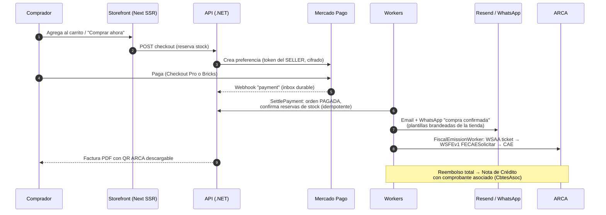
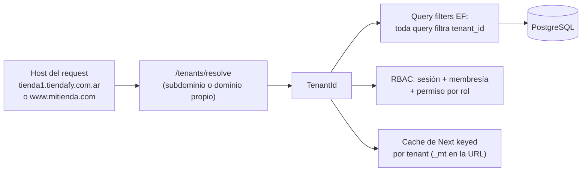

# Arquitectura visual de Tiendafy

Mapa completo del sistema: piezas, integraciones externas y los flujos que facturan.
(GitHub y VS Code renderizan los diagramas Mermaid automáticamente.)

## Vista completa del sistema

```mermaid
flowchart TB
    subgraph Clientes["👥 Quién usa qué"]
        Comprador["🛒 Comprador<br/>(tienda.tiendafy / dominio propio)"]
        Merchant["🧑‍💼 Merchant<br/>(admin.tiendafy)"]
        Googlebot["🤖 Googlebot / redes"]
    end

    subgraph Edge["🌐 Edge (prod)"]
        Caddy["Caddy<br/>TLS automático Let's Encrypt<br/>+ on-demand TLS p/ dominios propios<br/>(valida contra /tenants/resolve)"]
    end

    subgraph Apps["Aplicaciones"]
        Storefront["Storefront — Next.js 15 SSR<br/>multi-tenant por Host<br/>tienda + checkout + cuenta comprador<br/>SEO: sitemap/robots por host, JSON-LD"]
        Admin["Admin — React SPA (Vite)<br/>panel del merchant<br/>editor de diseño con preview live<br/>(iframe + postMessage + token firmado)"]
        API["API — .NET 10 monolito modular<br/>minimal APIs · EF Core · RBAC<br/>rate limiting · RFC 7807<br/>docs: /scalar (dev)"]
    end

    subgraph Modulos["Módulos del monolito (cada uno con su DbContext + filtro de tenant)"]
        Tenancy["Tenancy<br/>tiendas, subdominios,<br/>dominio propio, resolve por host"]
        Identity["Identity<br/>merchants + staff, RBAC,<br/>verificación de email"]
        Catalog["Catalog<br/>productos, variantes,<br/>categorías, import CSV"]
        Inventory["Inventory<br/>stock, reservas"]
        CheckoutM["Checkout<br/>sesiones, medios de envío"]
        Orders["Orders<br/>órdenes, reembolsos,<br/>fulfillment"]
        Payments["Payments<br/>conexión OAuth MP,<br/>webhooks, refunds"]
        Fiscal["Fiscal<br/>facturación ARCA:<br/>WSAA + WSFEv1, CAE,<br/>PDF con QR"]
        Themes["Themes<br/>diseño draft/published<br/>(blob JSON por tienda)"]
        Customers["Customers<br/>compradores, favoritos,<br/>mensajes de contacto"]
        Notifications["Notifications<br/>plantillas email/WhatsApp<br/>por tienda + contadores de uso"]
        Analytics["Analytics<br/>page views, visitas"]
        Media["Media<br/>subida de imágenes/videos"]
        Content["Content<br/>páginas CMS"]
        Discounts["Discounts<br/>cupones"]
    end

    subgraph Workers["⚙️ Background (hosted services, apagables por réplica: Workers:Enabled)"]
        WebhookW["PaymentWebhookWorker<br/>inbox durable de webhooks MP"]
        FiscalW["FiscalEmissionWorker<br/>outbox de facturas → CAE<br/>backoff + dead-letter"]
        CartW["AbandonedCartWorker<br/>recupero de carritos"]
        ImportW["Import workers<br/>CSV productos + imágenes"]
    end

    subgraph Datos["💾 Datos"]
        PG[("PostgreSQL<br/>(PgBouncer en dev)<br/>filas con tenant_id +<br/>query filters por módulo")]
        MinIO[("MinIO / S3<br/>media pública +<br/>adjuntos privados firmados")]
        DP["🔐 DataProtection keyring<br/>cifra: tokens MP, certificados<br/>y claves ARCA, tokens WhatsApp"]
    end

    subgraph Externos["☁️ Servicios externos"]
        MP["💳 Mercado Pago<br/>OAuth del seller (marketplace fee)<br/>Checkout Pro (redirect) y<br/>Bricks (on-site) + webhooks + refunds"]
        Resend["📧 Resend<br/>emails transaccionales<br/>(8 plantillas por tienda)"]
        Meta["💬 WhatsApp Cloud API (Meta)<br/>mensajes por plantilla por tienda"]
        ARCA["🧾 ARCA/AFIP<br/>WSAA (ticket de acceso) +<br/>WSFEv1 (CAE) · homologación/prod"]
        Turnstile["🛡️ Cloudflare Turnstile<br/>captcha (login/registro/contacto)"]
        GoogleO["🔑 Google OAuth<br/>login de compradores (opcional)"]
        Sentry["🚨 Sentry<br/>errores en los 3 (gated por DSN)"]
    end

    Comprador --> Caddy
    Merchant --> Caddy
    Googlebot --> Caddy
    Caddy --> Storefront
    Caddy --> Admin
    Caddy --> API
    Storefront -->|"SSR: X-Tenant-Id"| API
    Admin -->|"cookie sesión + X-Tenant-Id"| API
    API --> Modulos
    Modulos --> PG
    Media --> MinIO
    Workers --> PG
    Payments <--> MP
    WebhookW --> MP
    Fiscal <--> ARCA
    FiscalW --> ARCA
    Notifications --> Resend
    Notifications --> Meta
    API --> Turnstile
    Customers --> GoogleO
    Payments --> DP
    Fiscal --> DP
    Notifications --> DP
```

## El flujo que factura (venta punta a punta)

## Integraciones externas — qué usamos hoy

| Categoría | Proveedor | Cómo | Secretos |
|---|---|---|---|
| **Pagos** | Mercado Pago (único) | OAuth por merchant (cobra en SU cuenta; la plataforma toma marketplace fee %). Checkout Pro (redirect) o Bricks (on-site). Webhooks con inbox durable. Refunds totales y parciales. | Tokens del seller cifrados (DataProtection) |
| **Email** | Resend (único) | 8 plantillas transaccionales editables por tienda (bienvenida, activación, compra, pago, envío, cancelación, carrito abandonado, reset). Layout brandeado con logo/color de la tienda. | API key (user-secrets / env) |
| **WhatsApp** | Cloud API de Meta (único) | Conexión por tienda (phone number id + token), mensajes por plantilla espejo de los emails. | Token por tienda, cifrado |
| **Facturación** | ARCA/AFIP | WSAA (ticket cacheado y cifrado) + WSFEv1 (CAE online). Certificado X.509 por tienda: CSR generado en el panel → firmado en ARCA → activado. Homologación y producción. | Clave privada y cert cifrados; NUNCA salen por API |
| **Anti-bots** | Cloudflare Turnstile | Login/registro/contacto. Sin config = pasa (dev). | Site/secret key |
| **Login social** | Google OAuth | Solo compradores del storefront (opcional, gated por config). | Client id/secret |
| **Media** | MinIO (dev) / S3-R2 (prod) | Bucket público para fotos/videos de producto; adjuntos de chat privados con URLs firmadas. | Access keys |
| **Errores** | Sentry | Backend + storefront + admin, activo solo con DSN. | DSN por app |

> Infra presente pero **sin uso todavía**: Redis y RabbitMQ (levantados en dev-compose para cuando haga falta cache distribuido / colas persistentes).

## Multi-tenancy en una imagen

