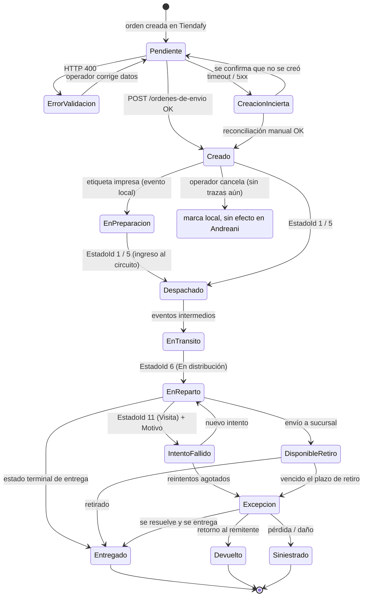

# 08 — Tracking y máquina de estados

Responde las preguntas 20, 21 y 23 del checklist.

## 8.1 Endpoints de seguimiento

| Operación | Método y path | Consulta por |
|---|---|---|
| Trazas (historial de eventos) | `GET /envios/{numeroAndreani}/trazas` | Número de envío |
| Estado actual del envío | `GET /envios/{numeroAndreani}` | Número de envío |
| Tracking masivo | `GET /envios` | ⛔ **Sin filtros documentados** |
| Documentos (constancias) | `GET /envios/{numeroAndreani}/multimedia` | Número de envío |

Contratos completos en `04-api-reference.md` §4.5.

> 🚨 **Advertencia de path.** La documentación oficial escribe estos métodos **sin prefijo de versión** (`envios/{n}/trazas`). Los SDKs de terceros usan `/v2/envios/...`. El único `/v2/` literalmente presente en la página oficial es el de la URL de etiqueta. **Probar ambas variantes en QA** antes de fijar la constante. Ver `04` §4.10.

> 🟢 **Nota de habilitación:** la sección oficial de trazas dice *"For this version you need to configure your username by the Andreani team. Contact your salesperson."* — **el endpoint de trazas requiere habilitación explícita por parte de Andreani.** Tener credenciales no alcanza. Ponerlo en el checklist de homologación.

### Consulta por referencia propia

⛔ **No existe.** No hay endpoint documentado para consultar un envío por la referencia externa del cliente. `GET /envios` (masivo) no publica ningún filtro.

Esto tiene dos consecuencias:
- La reconciliación de órdenes con creación incierta no se puede automatizar (ver `06` §6.5).
- El polling tiene que ser **envío por envío**, lo que multiplica las llamadas (ver `09-webhooks-o-polling.md`).

**Es una de las tres preguntas más importantes para Andreani.**

## 8.2 Las dos enumeraciones de estado

🚨 **Hallazgo crítico — GAP-17.** Andreani expone **dos catálogos de estado distintos** que es fácil confundir:

| | `EstadoId` (evento de traza) | `estadoId` (cabecera del envío) |
|---|---|---|
| Dónde aparece | `GET /envios/{n}/trazas` → `eventos[].EstadoId` | `GET /envios/{n}` → `estadoId` |
| Capitalización | **`EstadoId`** con E mayúscula | **`estadoId`** con e minúscula |
| Valores observados | 1, 5, 6, 11 | 21 |
| Semántica | Evento operativo puntual | Estado agregado del envío |

**La evidencia de que son distintos:** en los ejemplos oficiales, el envío tiene `fechaEstado: "2021-03-09T11:59:04"`, que es **exactamente** el timestamp del último evento de traza (`Visita`, `EstadoId: 11`). Pero su `estadoId` de cabecera es **21 / `Pendiente`**. Si fuera el mismo catálogo, ese envío tendría `estadoId: 11`.

**Regla de implementación:** persistir ambos por separado, nunca mezclarlos en la misma tabla de mapeo, y **nunca asumir que un id significa lo mismo en los dos contextos**.

## 8.3 Catálogo de estados — lo que está publicado

⛔ **GAP-02 — Andreani no publica una tabla de estados ni de motivos.** Los únicos valores conocidos aparecen incidentalmente dentro de los JSON de ejemplo de la documentación.

### `EstadoId` (trazas) — 🟢 OFICIAL

| EstadoId | Estado | Traduccion en el ejemplo | Ciclo |
|---|---|---|---|
| 1 | `Pendiente de ingreso` | `ENVIO INGRESADO AL SISTEMA` | `Distribution` |
| 5 | `Ingreso al circuito operativo` | `ENVIO INGRESADO AL SISTEMA` | `Distribution` |
| 6 | `En distribución` | `ENVIO CON SALIDA A REPARTO` | `Distribution` |
| 11 | `Visita` | *(repite el Motivo)* | `Distribution` |

### `estadoId` (envío) — 🟢 OFICIAL

| estadoId | estado |
|---|---|
| 21 | `Pendiente` |
| *(sin id)* | `Pendiente` — en la respuesta de creación, donde viene `estado` sin `estadoId` |

### `MotivoId` — 🟢 OFICIAL

| MotivoId | Motivo | Asociado a |
|---|---|---|
| 36 | `No se encuentra el titular` | `EstadoId` 11 (`Visita`) |

### `Ciclo`

Único valor observado: `Distribution`. ⛔ Lista completa no publicada. El nombre sugiere que existen otros ciclos (¿`Return`? ¿`Pickup`?).

### Lo que NO hay que usar

Circulan por la web tablas de "estados oficiales de Andreani" (sitios de rastreo, agregadores) con nombres como *En preparación, En sucursal Andreani, En tránsito, En proceso de entrega, Entrega fallida, Entregado*. **Ninguno de esos strings coincide con los valores reales de la API.** Es contenido SEO. Descartar.

### Cómo obtener el catálogo real

🟢 **La pista está en la documentación del webhook.** Los campos `event` y `reason` del payload de notificación de movimientos están descriptos como **"Client Code 1"** y **"Client Code 2"**. Es decir: **Andreani mapea sus `EstadoId`/`MotivoId` a códigos que define el cliente**.

Eso significa dos cosas:
1. El catálogo interno existe y es completo.
2. **Para configurar el webhook, Andreani necesariamente te lo entrega** — no podés definir tus "Client Codes" sin conocer los estados de origen.

**La vía real para conseguir la tabla completa es el proceso de alta del webhook, no la web.** Es la acción #1 del backlog de tracking.

## 8.4 Máquina de estados

Como el catálogo de Andreani no está publicado, el diagrama que sigue describe **la máquina de estados de Tiendafy**, que es la que sí controlamos, con los estados de Andreani conocidos anclados donde corresponde.



> **Advertencia honesta sobre este diagrama:** las transiciones que involucran `Entregado`, `Devuelto`, `Siniestrado` y `DisponibleRetiro` **no tienen `EstadoId` conocido**. Están en el diagrama porque son estados que la operación real produce y que el dominio de Tiendafy necesita, no porque estén documentados. Se completan cuando Andreani entregue el catálogo.

## 8.5 Tabla de mapeo a estados neutrales

Esta es la tabla que pide el brief. Los `EstadoId` marcados ⛔ son **placeholders**: la fila describe el estado neutral que necesitamos, y el id se completa al recibir el catálogo de Andreani.

| Estado Andreani | Código | Descripción | Estado neutral de Tiendafy | ¿Notifico al comprador? | ¿Requiere acción del operador? |
|---|---|---|---|---|---|
| `Pendiente de ingreso` | **1** 🟢 | Envío ingresado al sistema, aún no en el circuito físico | `CREATED` | No | No |
| `Ingreso al circuito operativo` | **5** 🟢 | Andreani tomó posesión física del paquete | `DISPATCHED` | **Sí** — "Tu pedido está en camino" | No |
| `En distribución` | **6** 🟢 | Salió a reparto | `OUT_FOR_DELIVERY` | **Sí** — "Llega hoy" | No |
| `Visita` | **11** 🟢 | Intento de entrega. **Ver el `MotivoId` para el detalle** | `DELIVERY_ATTEMPT_FAILED` | **Sí** — con el motivo traducido | **Sí, si se repite** |
| `Pendiente` (cabecera) | **21** 🟢 | Estado agregado del envío. **Distinto catálogo** | *(no mapear directo)* | No | No |
| Entregado | ⛔ | Entrega confirmada | `DELIVERED` | **Sí** — terminal, dispara encuesta y cierre | No |
| Disponible para retiro en sucursal | ⛔ | Llegó a la sucursal de destino | `AVAILABLE_FOR_PICKUP` | **Sí** — con dirección, horario y plazo | No |
| Rezago / no retirado | ⛔ | Venció el plazo de retiro | `EXCEPTION_UNCLAIMED` | **Sí** | **Sí** |
| Dirección incorrecta / insuficiente | ⛔ | No se pudo ubicar el domicilio | `EXCEPTION_BAD_ADDRESS` | **Sí** — pedir corrección | **Sí, urgente** |
| Rechazado por el destinatario | ⛔ | El comprador no lo aceptó | `EXCEPTION_REFUSED` | No — es acción suya | **Sí** |
| Devolución al remitente | ⛔ | Vuelve al comercio | `RETURNED_TO_SENDER` | **Sí** | **Sí** |
| Siniestro / extravío / daño | ⛔ | Pérdida o rotura | `LOST_OR_DAMAGED` | **Sí** | **Sí, urgente** — dispara reclamo |
| *(desconocido)* | cualquier id no mapeado | Estado nuevo o no catalogado | `UNKNOWN` | **No** | **Sí** — alerta al equipo de plataforma |

### Regla de oro del mapeo

**Persistir siempre el par crudo `(EstadoId, Estado)` y `(MotivoId, Motivo)` junto al estado neutral.** El mapeo es una capa de traducción, no un reemplazo. Cuando Andreani agregue un estado nuevo:

- El evento se guarda igual, con su id y su texto.
- Se mapea a `UNKNOWN`.
- **No se notifica al comprador** (nunca notificar sobre un estado que no entendemos).
- Se dispara una alerta para que el equipo agregue el mapeo.

Un `switch` con `default: throw` en el mapeo de estados es un incidente de producción esperando a pasar. Un `default: UNKNOWN + alerta` es un ticket.

### Qué notificar al comprador

Menos es más. La regla: **notificar solo cuando el comprador puede o debe hacer algo, o cuando la noticia es buena**.

| Notificar | No notificar |
|---|---|
| Despachado, En reparto, Entregado | Estados internos de circuito (ingreso al sistema, tránsito entre sucursales) |
| Intento fallido con motivo accionable | Estados desconocidos |
| Disponible para retiro, con plazo | Cambios que no alteran la expectativa de entrega |
| Problema que requiere su acción | — |

El texto que ve el comprador **nunca** es el `Estado` crudo de Andreani. `"Ingreso al circuito operativo"` no significa nada para una persona. Cada estado neutral tiene su copy propio, en español rioplatense, orientado a la acción.

## 8.6 Estado del Shipment cuando hay varios bultos

El tracking es **por bulto** (`numeroDeEnvio`). Un `Shipment` con 3 parcels tiene 3 historiales. El estado del `Shipment` se deriva con esta regla:

| Situación de los parcels | Estado del Shipment |
|---|---|
| Todos `DELIVERED` | `DELIVERED` |
| Alguno en excepción | `EXCEPTION` (gana el peor) |
| Todos con el mismo estado | Ese estado |
| Mezclados sin excepción | El **menos avanzado** (el envío no está más adelante que su bulto más atrasado) |

**Precedencia:** excepción > menos avanzado > entregado. Un envío con 2 bultos entregados y 1 perdido **no está entregado**.

En la vista del comprador, mostrar el estado agregado y, si hay más de un bulto, un desglose ("2 de 3 paquetes entregados").

## 8.7 Prueba de entrega

⛔ **GAP-16 — No hay endpoint de prueba de entrega estructurada.**

Lo disponible es `GET /envios/{numeroAndreani}/multimedia`:

```json
{
  "numeroDeEnvio": "360000036137650",
  "multimedia": [ { "meta": "constanciaelectronica", "contenido": "link" } ]
}
```

🟢 La doc describe que puede devolver *"Constancias Electrónicas", "Constancias de hojas de ruta", "remitos" u otros documentos digitales*.

**Lo que NO devuelve:** nombre de quién recibió, documento del receptor, timestamp estructurado, firma como dato, foto como dato. Solo links a documentos.

**Implicancia:** ante un reclamo de "no me llegó", el operador tiene que abrir el link y leer el documento a mano. No se puede automatizar la validación de entrega.

**Qué hacer:** guardar los links de `multimedia` asociados al parcel apenas el envío llega a un estado terminal, y exponerlos en el panel admin como "Constancia de entrega". No intentar parsear el documento.

**Preguntar:** ¿existe una API de prueba de entrega estructurada? ¿Qué metas puede devolver `multimedia`?

## 8.8 GAPs de este documento

| ID | GAP | Pregunta a Andreani |
|---|---|---|
| GAP-02 | **Catálogo completo de `EstadoId` y `MotivoId`** | **Necesito la tabla completa de estados y motivos, con cuáles son terminales y cuáles requieren acción.** Vía: proceso de alta del webhook |
| GAP-17 | Dos enumeraciones de estado | ¿Cuál es la relación entre `EstadoId` (traza) y `estadoId` (envío)? ¿Son catálogos distintos? |
| — | Valores de `Ciclo` | ¿Cuáles son los ciclos posibles además de `Distribution`? |
| — | Consulta por referencia propia | ¿Cómo consulto el estado usando mi referencia externa? |
| — | Filtros de `/envios` | ¿Qué filtros y paginación acepta el tracking masivo? |
| GAP-16 | Prueba de entrega | ¿Hay API estructurada de POD? ¿Qué valores de `meta` devuelve `multimedia`? |
| — | Confiabilidad de trazas v2 | 🟡 Un SDK advierte que v2 omite el estado de entrega y hay que consultar la orden. ¿Es así? |
