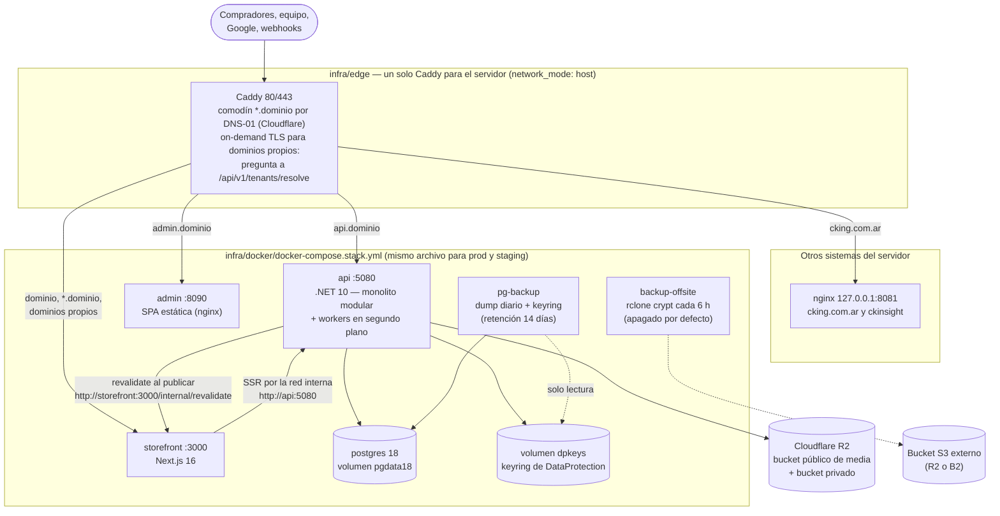
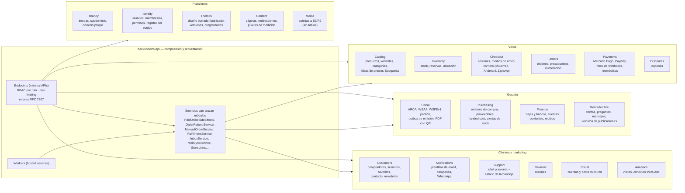
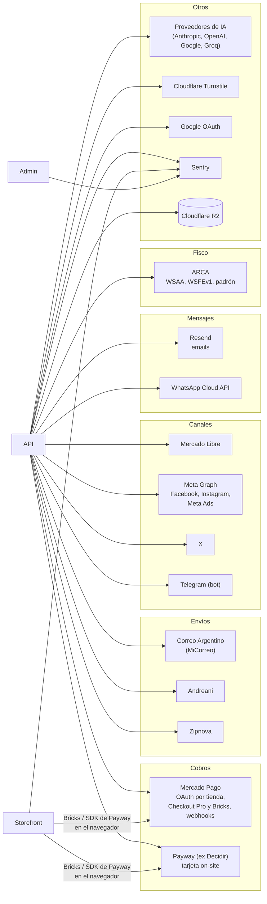
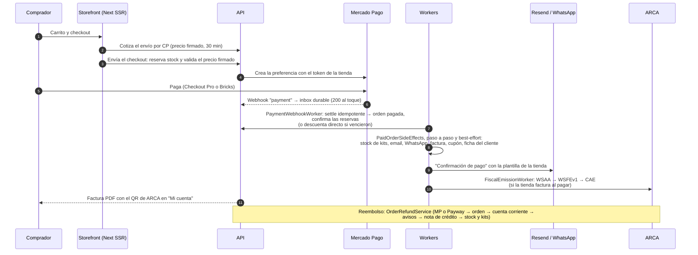
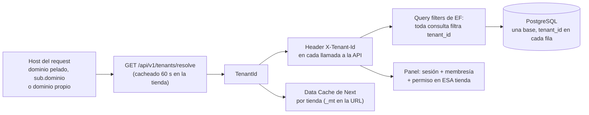

# Arquitectura

El sistema en diagramas: dónde corre cada pieza, qué hay adentro de la API, con
qué servicios externos habla y cómo viaja una venta. GitHub y VS Code dibujan
los bloques Mermaid solos.

Tiendafy es la plataforma de UNA importadora con varias tiendas propias: una
instalación, varias tiendas (tenants), una base. Está en producción desde el
13-oct-2026.

## 1. El servidor de producción

Una VPS con Docker. Adelante, un Caddy que es el borde de TODO el servidor
(Tiendafy y los otros sistemas de la empresa); atrás, el stack de Tiendafy con
cada servicio escuchando solo en `127.0.0.1`.

- **Una imagen por app para todos los ambientes**: la URL de la API, el origin
  del panel y los DSN de Sentry se inyectan al arrancar el contenedor, no al
  compilar (ver [ADR 0004](./adr/0004-una-imagen-y-un-compose.md)).
- **Migraciones como paso de deploy**: `infra/deploy.sh` trae las imágenes,
  copia la base, corre `dotnet Api.dll migrate` con la imagen nueva y recién
  ahí recambia los contenedores (`Database__MigrateOnStartup=false` en prod).
- **CI/CD**: `docker-release.yml` construye una vez por push a `main` y publica
  en GHCR. Hoy se despliega a mano en el servidor (`./infra/deploy.sh prod
  sha-XXXXXXX`): el workflow sabe desplegar staging y producción por SSH, pero
  saltea esos pasos mientras el repo no tenga las variables `STAGING_DOMAIN` y
  `PLATFORM_DOMAIN` (ver [despliegue.md](./despliegue.md)).
- **El keyring es crítico**: `dpkeys` cifra los secretos de las tiendas. Sin él
  la API no arranca en producción (fail-fast), y un dump sin su keyring no
  sirve; por eso `pg-backup` copia los dos.

## 2. Adentro de la API

Un proceso .NET con 21 módulos. Cada módulo tiene su `DbContext` (salvo Media,
que no guarda filas) y sus tablas; la orquestación entre módulos vive en
`backend/src/Api/` (endpoints, servicios y workers), no en los módulos.

Reglas que hacen cumplir los tests de arquitectura
(`backend/tests/UnitTests/Architecture/`):

- Un módulo solo puede referenciar el `.Contracts` de otro, y ningún módulo
  conoce a la Api (`ModuleBoundariesTests`).
- Toda entidad con `TenantId` tiene `HasQueryFilter`, o figura en una lista de
  excepciones con su motivo (`TenantQueryFilterTests`). Ver
  [ADR 0003](./adr/0003-multi-tienda-con-rls.md).
- Toda ruta exige un permiso de la matriz o está en una lista de excepciones
  con su motivo (`EndpointPermissionTests`, en los tests de integración). Ver
  [permisos.md](./permisos.md).

### Workers

Todos corren dentro del proceso de la API y hacen polling a Postgres (no hay
broker de mensajes; ver [ADR 0005](./adr/0005-segundo-plano-con-polling-a-postgres.md)).
`Workers:Enabled=false` apaga los de polling en una réplica extra.

| Worker | Cada | Qué hace |
| --- | --- | --- |
| `PaymentWebhookWorker` | 5 s | Drena el inbox de webhooks de Mercado Pago (claim por fila, reintentos con escala hasta ~1 día) |
| `PaywayReconciliationWorker` | 1 min | Reconsulta en Payway los cobros que quedaron sin resolver (timeout, revisión, 3DS), con intervalo creciente hasta 3 días |
| `FiscalEmissionWorker` | 10 s | Outbox de facturas: pide el CAE a ARCA, con backoff exponencial y dead-letter a los 8 intentos |
| `MeliNotificationWorker` | 5 s | Inbox de notificaciones de Mercado Libre |
| `MeliStockSyncWorker` | 5 min | Empuja stock (y precio, si la sincronización está prendida) a las publicaciones vinculadas |
| `AiCatalogWorker` | 5 s | Fichas del catálogo con IA: un trabajo por tienda, 3 productos en paralelo, claim por fila (vence a los 10 min), estado guardado en cada paso y pausa por tope. Ver [ia.md](./integraciones/ia.md#fichas-del-catálogo-en-lote) |
| `SocialPublishWorker` | 60 s | Publica los posts programados, red por red, con claim atómico |
| `CampaignWorker` | 20 s | Envía las campañas de email programadas |
| `AbandonedCartWorker` | 15 min | Recupero de carritos abandonados |
| `FavoriteAlertWorker` | 30 min | Avisos de baja de precio y reposición de favoritos |
| `BackInStockWorker` | 5 min | "Avisame cuando ingrese" |
| `ReviewRequestWorker` | 1 h | Pide la reseña unos días después del despacho |
| `StockAlertWorker` | 5 min | Alertas de stock bajo (inmediatas o resumen diario) |
| `ThemeScheduleWorker` | 30 s | Publica los diseños programados |
| `OfflinePaymentExpiryWorker` | 1 min | Vence las órdenes de transferencia/efectivo no pagadas |
| `AbandonedPaymentWorker` | 10 min | Cancela las ventas del checkout con Mercado Pago o Payway sin pagar a las 24 h (antes busca si hay un pago en curso; sin aviso al comprador) |
| `ExpiredReservationsJob` | 30 s | Libera reservas de stock vencidas (siempre prendido) |
| `ExpiredCheckoutWorker` | 1 min | Cierra los checkouts con el plazo cumplido: vencidos (sin reservas activas, transferencia en plazo ni venta cobrada) o completados (terminaron en venta cobrada) |
| `ProductImportWorker` / `ProductImageImportWorker` | cola en memoria | Importación de productos por CSV y de imágenes por URL (siempre prendidos) |

## 3. Servicios externos

| Área | Proveedor | Cómo | Secretos |
| --- | --- | --- | --- |
| Cobros | Mercado Pago | OAuth por tienda (cobra en la cuenta de la tienda; `MarketplaceFeePercent` existe y arranca en 0). Checkout Pro (redirect) o Bricks (on-site). Webhooks validados por HMAC a un inbox durable. Reembolsos totales y parciales. | Tokens del vendedor cifrados |
| Cobros | Payway (ex Decidir) | Tarjeta on-site con el SDK de Payway; el pago se crea desde la API. | Credenciales por tienda, cifradas |
| Cobros | Transferencia / efectivo | Sin proveedor: la orden queda pendiente con instrucciones de pago y vence sola. | — |
| Email | Resend | 15 plantillas automáticas editables por tienda (`EmailTemplateCatalog`) y campañas; layout con logo y color de la tienda. Sin API key, se escriben en el log. | API key + secreto del webhook |
| WhatsApp | Cloud API de Meta | Conexión por tienda, mensajes por plantilla espejo de los emails. | Token por tienda, cifrado |
| Facturación | ARCA | WSAA (ticket cacheado y cifrado) + WSFEv1 (CAE) + padrón (constancia de inscripción: condición de IVA del receptor). Certificado por tienda: CSR generado en el panel. | Clave privada y certificado cifrados; nunca salen por la API |
| Envíos | Correo Argentino, Andreani, Zipnova | Cotización en el checkout con precio firmado (TTL 30 min), alta de envíos y etiquetas desde la venta. | Credenciales por tienda, cifradas |
| Canal | Mercado Libre | OAuth por tienda; ventas, preguntas, mensajes, stock unificado, publicar. Sin app configurada, el canal está apagado; la conexión de demo (`POST /dev/demo-seed`) contesta con datos fijos (`MeliDemoFeed`) sin salir a la red. | Tokens cifrados; refresh serializado por tienda |
| Redes | Meta (Facebook/Instagram), X, Telegram | Posts multi-red programados. | Tokens cifrados |
| Publicidad | Meta Ads | Gasto por campaña para el ROAS en Rentabilidad. | Token cifrado |
| IA | Anthropic, OpenAI, Google, Groq | Respuestas a preguntas de ML y del chat, textos de posts y de productos, lectura de facturas de compra encadenada (extraer, validar en código, una sola corrección y emparejar las líneas con la orden). Cada tienda carga sus claves y elige el modelo por tarea, con tope mensual; sin clave o con la IA apagada, el botón dice por qué no está disponible. Ver [integraciones/ia.md](integraciones/ia.md). | Claves por tienda, cifradas |
| Anti-bots | Cloudflare Turnstile | Login, registro y contacto. Sin config, pasa (dev). | Site/secret key |
| Login social | Google OAuth | Solo compradores, opcional. | Client id y secret |
| Media | MinIO (dev) / Cloudflare R2 (prod) | Bucket público para fotos y videos; bucket privado para adjuntos del chat, con URL firmada de 15 min. | Access keys |
| Errores | Sentry | API, tienda y panel; activo solo con DSN. | DSN por app |

En producción hoy andan el email y las imágenes en R2; el resto espera
credenciales reales o la primera prueba con una cuenta de verdad. Qué le falta
a cada una: [integraciones/](./integraciones/README.md).

## 4. Una venta de punta a punta

Payway (en el momento o, si quedó en el medio, cuando `PaywayReconciliationWorker`
lo reconsulta) y la venta manual del panel llegan al mismo `PaidOrderSideEffects`;
la venta manual no manda WhatsApp.

**La sesión de checkout** nace cuando el comprador escribe su email
(`POST /checkout/contact`), no recién al pagar, y dura 30 minutos: desde que
se arma, y de nuevo desde que se envía (lo mismo que dura la reserva). Cada
dato de contacto le estira el plazo y queda en `LastActivityAtUtc`, desde
donde se cuenta el recordatorio de carrito abandonado. `Open` → `Submitted` al
reservar; después `ExpiredCheckoutWorker` la cierra: `Completed` si terminó en
una venta cobrada, `Expired` si venció sin reservas activas (una
transferencia pendiente estira la reserva y la sesión espera; si todo era de
stock sin límite, que no se reserva, la sostiene la venta pendiente en plazo).

- Una sesión vencida no se envía ni se paga ("La compra venció: volvé a
  empezar desde el carrito"). La tienda paga desde la sesión abierta mientras
  siga vigente y con el mismo carrito, y arma una nueva si no, o después de un
  intento enviado: el comprador nunca queda trabado.
- **Una sesión produce como mucho una venta**: índice único en
  `orders.checkout_session_id` (las ventas que no nacen de un checkout llevan
  un id propio). `CheckoutOrderFactory` reusa la orden pendiente del mismo
  medio, así un doble clic o dos pestañas no crean dos ventas ni cobran dos
  veces (la clave de idempotencia de Mercado Pago es el id de la orden); una
  pagada, cancelada o de otro medio da 409.
- Carritos abandonados (pantalla y recordatorio, `Api/Notifications/AbandonedCarts.cs`)
  cuenta uno por comprador lo que no es `Completed` y no terminó en una
  compra: las sesiones vencidas son carritos abandonados.

## 5. Multi-tenancy

- El dominio pelado lo atiende la tienda de `PRIMARY_STORE_SUBDOMAIN`.
- Panel: cookie de sesión `tiendafy.session` + `X-Tenant-Id` de la tienda
  elegida. Comprador: cookie HttpOnly por tienda (`/shop/auth`).
- Las escrituras con cookie de comprador exigen `Origin` propio
  (`RequireSameOriginForWrites`).
- El editor de diseño muestra la tienda en un iframe con el borrador, vía
  token de preview firmado y `postMessage` con origins validados.
