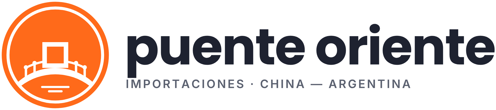

# Puente Oriente · Guía de marca

Versión 1.0 · Octubre 2026

Puente Oriente es una empresa de importaciones que conecta a pymes y emprendedores argentinos con fábricas de China: búsqueda de proveedor, negociación en origen, logística y nacionalización. La marca toma el lenguaje visual de los marketplaces B2B chinos (naranja intenso, mucho blanco, formas redondas, información densa y clara) y lo cruza con dos símbolos: la moneda china de agujero cuadrado (el comercio) y el puente arqueado con pabellón (la conexión).

## Esencia

- **Promesa:** importar de China sin intermediarios ni sorpresas.
- **Personalidad:** confiable, directa, práctica, cercana. Sabe de comercio exterior y lo explica sin jerga.
- **Público:** dueños de pymes, comercios y emprendedores en Argentina que quieren traer mercadería propia, desde una caja hasta un contenedor.
- **Nombre:** se escribe `Puente Oriente` en textos y `puente oriente` (minúsculas) solo dentro del logotipo. Nunca "P. Oriente", "PO" ni "Puente de Oriente".
- **Nombre en chino:** 东方桥 (Dōngfāng Qiáo, "puente del Este"). Va en tarjetas, firmas y documentos para proveedores, en el estilo `nombre-chino`, siempre acompañando al nombre en español, nunca solo.

## Logo

El isotipo es una moneda china: disco naranja, aro interior blanco y el agujero cuadrado en el centro. Ese cuadrado es también el pabellón de un puente arqueado con baranda de postes y bolitas, y debajo hay dos líneas de agua. Es plano, de dos tintas, y todos los archivos son vectoriales con el texto convertido a curvas.

| Archivo | Cuándo usarlo |
|---|---|
| `logo-horizontal.svg` | Versión principal. Web, firmas, documentos, facturas. Logotipo en `tinta`, tagline en `piedra`. |
| `logo-horizontal-naranja.svg` | Piezas de marketing sobre blanco donde se busca más impacto. |
| `logo-horizontal-negativo.svg` | Sobre `tinta`, fotos oscuras o fondos de color. Isotipo invertido y textos en blanco. |
| `logo-horizontal-chino.svg` | Comunicación con proveedores, ferias (Canton Fair), tarjetas bilingües. |
| `logo-vertical.svg` / `logo-vertical-negativo.svg` | Formatos cuadrados o angostos: posteos, carteles, packaging. |
| `isotipo-naranja.svg` | Avatar de redes, sello, ícono de app. El isotipo puede ir solo cuando la marca ya está presente en el contexto. |
| `isotipo-negativo.svg` | Isotipo sobre fondos naranja o de color: disco blanco con dibujo naranja. |
| `isotipo-tinta.svg` | Isotipo sobre fondos claros cuando el naranja compite con la pieza. |
| `isotipo-mono-negro.svg` | Una sola tinta: sellos de goma, grabado láser, stencil para cajas y pallets, vinilo de corte. El dibujo es calado. |
| `isotipo-simple-favicon.svg` | Por debajo de 48 px: favicon, notificaciones. Sin baranda ni agua, trazos más gruesos. |

**Área de resguardo:** dejá libre alrededor del logo un margen igual a 1/4 del diámetro del isotipo. Ningún texto, borde ni foto entra en esa zona.

**Tamaños mínimos:** isotipo completo 48 px / 12 mm; por debajo usá `isotipo-simple-favicon.svg` (hasta 16 px / 5 mm). Logo horizontal 140 px / 35 mm de ancho; si no entra, usá solo el isotipo.

**Usos incorrectos:**
- No cambies los colores fuera de las versiones de la tabla ni uses el naranja de otro tono.
- No agregues sombras, degradés, biseles, contornos ni efectos 3D.
- No deformes, rotes ni inclines el logo.
- No recompongas el logotipo con otra tipografía ni muevas la posición del isotipo.
- No pongas el isotipo naranja sobre fondos naranja o rojos: usá `isotipo-negativo.svg`.
- No lo pongas sobre fotos con mucho detalle sin una franja o fondo liso detrás.

## Color

Proporción de uso en cualquier pieza: 60 % blanco y superficies claras (`superficie`, `superficie-alt`), 30 % `naranja`, 10 % `tinta`. El `rojo-laca` es un acento puntual, nunca más de un elemento por pieza.

- Texto sobre blanco: `tinta` para lo principal, `piedra` para lo secundario, `naranja-texto` para links y precios.
- Botón primario: relleno `naranja`, texto `on-naranja` (es `tinta`), forma `radius-pill`; hover `naranja-texto`.
- El blanco sobre `naranja` solo va en el isotipo, ilustraciones y titulares de banner de 32 px o más en bold. En botones, chips y texto de interfaz usá `on-naranja`.
- Bloques destacados (beneficios, cotizador, banners suaves) sobre `arena`.
- Estados: `exito` y `error`, siempre con palabra o ícono además del color.
- Para imprenta, el naranja de marca es aprox. Pantone 1585 C / CMYK 0 70 95 0. Pedí prueba de color: el naranja en papel sale más apagado que en pantalla.

## Tipografía

Tres familias, todas gratuitas en Google Fonts:

- **Poppins** (`display`, `h1`, `h2`) para titulares. Geométrica y redonda, acompaña al círculo del isotipo. El logotipo está hecho en Poppins Bold.
- **Inter** (`titulo-card`, `body`, `small`, `label`) para texto corrido, interfaz, tablas y specs. Muy legible en tamaños chicos y con números tabulares para precios y cantidades.
- **Noto Sans SC** (`nombre-chino`) para todo texto en chino simplificado.

Reglas: una sola vez `display` por pieza. Mayúsculas solo en `label`, con su espaciado. Precios y cantidades con números tabulares. No mezcles otras tipografías.

## Voz y tono

Hablamos en español rioplatense, de vos, como un despachante que es amigo: claro, concreto y sin vender humo. Números reales antes que adjetivos.

- Sí: "Te conseguimos el proveedor, negociamos el precio en origen y te entregamos la mercadería nacionalizada en tu depósito."
- Sí: "Contenedor 40' HC · Shenzhen → Buenos Aires · 35 días de tránsito."
- No: "¡¡Las MEJORES oportunidades del mercado asiático!! 🚀🔥"
- No: jerga sin explicar (FOB, CIF, MOQ, DJAI) en piezas para público general. Si aparece, explicala la primera vez.

Sin emojis en piezas institucionales. En redes, como mucho uno por posteo y nunca como viñeta.

## Iconografía

Íconos de línea de 2 px con terminaciones redondeadas (Lucide o Phosphor Regular, ambos libres). Color `tinta` por defecto, `naranja` para el ícono destacado de un bloque. Temas típicos: contenedor, barco, avión, caja, aduana, fábrica, documento, calculadora. No uses emojis como íconos ni ilustraciones 3D genéricas.

## Fotografía e imágenes

- Producto sobre fondo blanco o `superficie-alt`, bien iluminado, estilo catálogo de marketplace.
- Fotos reales de puerto, contenedores, fábricas y ferias. Mejor fotos propias de viajes y proveedores que stock.
- Evitá el stock de "apretón de manos", globos terráqueos y dragones.
- Si una foto lleva logo encima, usá la versión negativo sobre una zona oscura y limpia.

## Formas y composición

- El círculo es el recurso gráfico de la marca: botones `radius-pill`, avatares redondos, sellos circulares de "Nuevo" u "Oferta" en `rojo-laca`.
- Cards con `radius-md`, borde `borde` y sin sombras pesadas.
- Grillas densas tipo catálogo con mucho blanco entre bloques (`space-6` entre cards, `space-12` entre secciones).

## Paleta

| Color | Token | HEX | RGB | Uso |
|---|---|---|---|---|
| Naranja Puente | `naranja` | #FF6A1A | 255 106 26 | Color de marca: isotipo, banners, botón primario. No como texto sobre blanco. Pantone 1585 C aprox. |
| Naranja texto | `naranja-texto` | #C2410C | 194 65 12 | Links, precios y texto naranja sobre fondos claros. |
| Tinta | `tinta` | #1E2230 | 30 34 48 | Texto principal, logotipo, fondos oscuros, texto sobre naranja. |
| Piedra | `piedra` | #5B6170 | 91 97 112 | Texto secundario y tagline. |
| Rojo laca | `rojo-laca` | #C8102E | 200 16 46 | Acento puntual de ofertas. Uno por pieza. |
| Arena | `arena` | #FFF3EB | 255 243 235 | Fondo de bloques destacados. |
| Niebla | `superficie-alt` | #F4F5F7 | 244 245 247 | Secciones alternas y cards. |
| Blanco | `superficie` | #FFFFFF | 255 255 255 | Fondo por defecto. |
| Éxito | `exito` | #067647 | 6 118 71 | Estados OK, con texto o ícono. |
| Error | `error` | #B42318 | 180 35 24 | Errores, con texto o ícono. |

## Escala tipográfica

| Estilo | Familia | Tamaño / interlineado | Peso | Uso |
|---|---|---|---|---|
| Display | Poppins | 48 / 52 px | 700 | Una vez por pieza. |
| H1 | Poppins | 32 / 40 px | 700 | Título de página o slide. |
| H2 | Poppins | 24 / 32 px | 600 | Títulos de sección. |
| Título de card | Inter | 18 / 26 px | 600 | Producto, card. |
| Cuerpo | Inter | 16 / 24 px | 400 | Texto corrido. |
| Chico | Inter | 14 / 20 px | 400 | Specs, notas. |
| Etiqueta | Inter | 12 / 16 px, +8 % | 600 | Mayúsculas: tagline, chips. |
| Nombre chino | Noto Sans SC | 20 / 28 px, +20 % | 700 | Junto al logo. |

Espaciado en múltiplos de 4 px (4, 8, 16, 24, 32, 48). Radios: 4 px chips e inputs, 8 px cards, píldora en botones y buscador.

## Aplicaciones

Cómo se arma la marca en las piezas de todos los días.

### Tarjeta personal (90 × 50 mm)

- **Frente:** fondo `naranja` pleno con `isotipo-naranja.svg` centrado a 24 mm de diámetro. Como el disco es del mismo naranja que el fondo, solo se ve el dibujo blanco de la moneda y el puente. Nada más en el frente.
- **Dorso:** fondo blanco, `logo-horizontal.svg` arriba a la izquierda a 40 mm de ancho; nombre en Poppins Bold 10 pt `tinta`, cargo en Inter 7 pt `piedra`, datos de contacto en Inter 7.5 pt; 东方桥 en Noto Sans SC Bold `naranja-texto` abajo a la derecha.
- Papel ilustración 350 g mate. Si hay presupuesto, el isotipo del frente con laca sectorizada.

### Firma de mail

`logo-horizontal.svg` exportado a PNG de 280 px de ancho (se ve a 140 px), nombre en negrita, cargo y teléfono en una línea gris, web en `naranja-texto`. Sin frases motivacionales ni banners animados.

### Redes sociales

- **Avatar:** `isotipo-naranja.svg`. Al ser redondo ya encaja en el recorte circular de Instagram, WhatsApp y LinkedIn.
- **Posteos:** fondo blanco o `arena`, titular en Poppins Bold `tinta`, un dato duro en `naranja` grande, logo vertical chico abajo a la derecha. Un solo sello `rojo-laca` si hay oferta.
- **Historias:** franja inferior `naranja` con texto `on-naranja`.

### Web y tienda

- Header blanco con `logo-horizontal.svg`, buscador `radius-pill` con borde `naranja` y botón de buscar relleno `naranja`, como en los marketplaces B2B.
- Cards de producto en `superficie-alt`: foto, `titulo-card`, precio en `naranja-texto`, MOQ y tiempo de tránsito en `small`.
- Favicon: `isotipo-simple-favicon.svg`.

### Cajas, pallets y contenedores

- `isotipo-mono-negro.svg` como stencil o sello de goma en una tinta (negro o naranja).
- Etiqueta de despacho con logo horizontal, 东方桥 y datos del envío en Inter; en la etiqueta todo en `tinta` sobre blanco para que escanee bien.

### Documentos

Cotizaciones, proformas y presentaciones: hoja blanca, logo horizontal arriba a la izquierda, línea fina `naranja` bajo el encabezado, tablas en Inter con números tabulares y filas alternas en `superficie-alt`.

## En la tienda (Tiendafy)

El diseño listo **Puente Oriente** del editor de la tienda (grupo "Marcas del
grupo", en `admin/src/lib/themePresets.ts`) es esta guía pasada a la tienda:

- Colores: primario `naranja` #FF6A1A, hover `naranja-texto` #C2410C, fondo
  `superficie`, fondo alterno y cards `superficie-alt` #F4F5F7, texto `tinta`
  #1E2230; header blanco con el logo horizontal y buscador.
- El texto sobre el naranja no es un color fijo: la tienda lo elige por
  contraste y sale oscuro (#111827, 6,2:1; el blanco daría 2,9:1). Para los
  links y precios usa una variante oscura del primario que llegue a 4,5:1.
- Poppins para titulares e Inter para el texto, servidas por la propia tienda
  (`storefront/src/app/fonts/`); íconos Lucide; formas redondeadas.
- Logo y favicon: `/marca/puente-oriente/logo-horizontal.svg` y
  `/marca/puente-oriente/favicon.ico`, copias de los de esta carpeta en
  `storefront/public/marca/puente-oriente/`. Si cambia un archivo acá, hay que
  copiarlo también allá.

## Prompts para Gemini

Los prompts para explorar variantes del isotipo y armar mockups con el logo
real están en [prompt-gemini.md](./prompt-gemini.md). El master del logo son
los SVG de esta carpeta: lo que salga de Gemini se redibuja en vector antes de
usarlo.
