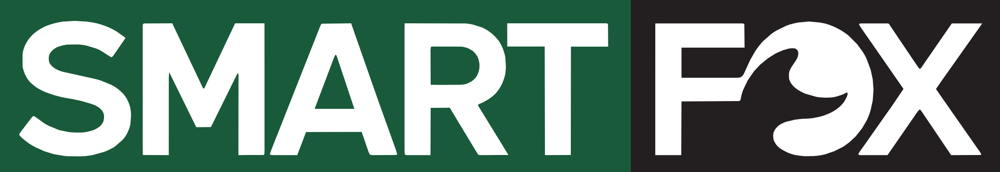

# SmartFox · Guía de marca

Versión 1.0 · Octubre 2026



## 1. Esencia de marca

SmartFox es una marca de motos urbanas importadas para el mercado argentino. Motos para moverse todos los días: al laburo, a la facu, a repartir.

El nombre junta dos ideas: **smart**, la decisión inteligente de una moto económica, simple y confiable; y **fox**, el zorro, ágil y astuto para moverse por la ciudad. La identidad es directa y de bloques: verde bosque y negro asfalto, letras blancas, esquinas rectas, nada decorativo.

| Concepto | Definición |
|---|---|
| Promesa | Una moto que hace rendir cada peso y cada minuto. |
| Personalidad | Astuta, ágil, directa, confiable. Tiene calle: habla claro y con datos. |
| Público | Trabajadores que usan la moto todo el día (delivery, mensajería, oficios), estudiantes y jóvenes con su primera moto, comercios que necesitan movilidad barata. |
| Diferencial | Buena relación precio/consumo, repuestos y service disponibles, garantía local a través del importador. |
| Tagline recomendado | Astuta por naturaleza. |
| Alternativas | "Moverse es de vivos." · "La moto inteligente." |

### Nombre

- En textos: **SmartFox**, una palabra, dos mayúsculas. En titulares en mayúsculas: **SMARTFOX**.
- Nunca "Smart Fox", "Smartfox", "SF" ni "Smart-Fox".
- Modelos: **SmartFox + nombre o cilindrada** (ej. "SmartFox [Urbana] 150"), con un único sistema para toda la línea.

### Relación con Puente Oriente

SmartFox tiene identidad propia. Puente Oriente aparece solo como línea de texto ("Importa y distribuye: Puente Oriente") en fichas, manuales, garantías y packaging, en Barlow y gris llanta. Los dos logos no se combinan en piezas de consumo final.

## 2. El logo

Dos bloques rectos: SMART en blanco sobre verde bosque y FOX en blanco sobre negro asfalto. El bloque verde ocupa el 63 % del ancho. La "O" de FOX es el zorro: una cola que nace del brazo de la F y se enrosca.

> Los SVG son una vectorización fiel del PNG original (1024 × 177 px): bloques exactos y letras calcadas, 99 % de coincidencia píxel a píxel. Para frentes de más de 3 m, conviene un redibujo final de las curvas de la S y de la cola.

### Versiones

| Archivo | Uso |
|---|---|
| `smartfox-logo` | Principal. Sobre blanco, negro (el bloque FOX se funde, está permitido) o fotos. |
| `smartfox-logo-apilado` | Formatos cuadrados y verticales. |
| `smartfox-logo-una-tinta` | Serigrafía, sellos, grabado; letras caladas. |
| `smartfox-tipografico` | Sin bloques, sobre claros. |
| `smartfox-tipografico-blanco` | Sobre verde, negro o fotos oscuras; vinilo de corte. |
| `smartfox-tipografico-negro` | Una tinta sobre claros; motos blancas o plateadas. |
| `smartfox-isotipo-negro` / `-verde` | **Propuesta a aprobar.** La cola del zorro en un cuadrado: avatar, favicon, merchandising. |

### Área de resguardo y tamaños

- Margen libre alrededor del logo: **X = 1/4 de la altura del logo**.
- Mínimos: principal y tipográfico 160 px / 35 mm de ancho; apilado 90 px / 20 mm; isotipo 16 px / 6 mm; bordado 60 mm de ancho.

### Usos incorrectos

No deformar, no invertir los bloques (SMART va en verde), no cambiar colores, no agregar degradés, sombras ni esquinas redondeadas, no inclinar, no reordenar (siempre SMART primero).

## 3. Color

| Color | HEX | RGB | Impresión | Uso |
|---|---|---|---|---|
| Verde Bosque | #195A3A | 25 90 58 | Pantone 7484 C aprox. | Color principal, bloque SMART, fondos. |
| Negro Asfalto | #231F20 | 35 31 32 | Negro 100 K (plenos: 60 40 40 100) | Bloque FOX, fondos, texto sobre claros. |
| Blanco | #FFFFFF | 255 255 255 | — | Letras del logo, texto sobre bloques. |
| Amarillo Ruta | #FFC72C | 255 199 44 | Pantone 123 C | Acento: precios, promos, botones. |
| Gris Cemento | #ECEBE8 | 236 235 232 | CMYK 0 0 2 7 aprox. | Fondo de fotos de producto y catálogos. |
| Verde Claro | #E7F0EB | 231 240 235 | CMYK 4 0 2 6 aprox. | Recuadros y destacados suaves. |
| Gris Llanta | #5E5A5B | 94 90 91 | CMYK 0 4 3 63 aprox. | Texto secundario y legales. |
| Rojo Freno | #C62828 | 198 40 40 | Pantone 1797 C aprox. | Solo alertas, con palabra que lo explique. |

**Proporción:** 40 % verde, 30 % negro, 25 % blanco o cemento, 5 % amarillo.

**Contraste:** blanco sobre verde 8.2:1 y sobre negro 16.3:1; amarillo sobre negro 10.5:1 y sobre verde 5.3:1; negro sobre amarillo 10.5:1. **Nunca** amarillo sobre blanco (1.6:1) ni verde sobre negro (2:1).

## 4. Tipografía

Todas gratuitas en Google Fonts.

- **Montserrat** (800–900, mayúsculas): titulares. La más cercana a las letras del logo.
- **Barlow** (400–600): texto corrido. Nació inspirada en la señalética vial.
- **Barlow Condensed** (600–700, mayúsculas): fichas técnicas, precios, etiquetas.

| Estilo | Familia | Tamaño / interlineado | Peso | Uso |
|---|---|---|---|---|
| Display | Montserrat | 56 / 56 px, mayúsculas | 900 | Una vez por pieza. |
| H1 | Montserrat | 36 / 40 px, mayúsculas | 800 | Títulos de página. |
| H2 | Montserrat | 24 / 28 px, mayúsculas | 800 | Títulos de sección. |
| Bajada | Barlow | 20 / 28 px | 500 | Primer párrafo. |
| Cuerpo | Barlow | 16 / 24 px | 400 | Texto corrido. |
| Ficha | Barlow Condensed | 16 / 20 px, +4 % | 600 | Specs, etiquetas. |
| Precio | Barlow Condensed | 48 / 48 px | 700 | Precios y cuotas. |
| Legal | Barlow | 11 / 14 px | 400 | Letra chica. |

## 5. Recursos gráficos

- **Bloque partido:** cada pieza se divide en dos bloques rectos, verde y negro, en proporción 62/38, como el logo. Mensaje en uno; foto, precio o cola en el otro.
- **Esquinas siempre rectas.** Sin diagonales, degradés ni bordes redondeados.
- **Franja de precio:** rectángulo amarillo plano con el número en negro.
- **La cola:** la cola del zorro en grande, cortada por el borde, tono sobre tono. Una por pieza, nunca encima del texto.
- **Íconos:** línea de 2 px (Tabler o Lucide). Set de ficha: motor, surtidor, velocímetro, tanque, balanza, escudo, llave.

## 6. Voz y tono

De vos, con calle y con datos. Astuta, no canchera de más.

| Así sí | Así no |
|---|---|
| "150 cc, [40] km por litro y service cada [3.000] km. Hacé la cuenta." | "¡¡La moto MÁS RÁPIDA del mercado!! 🔥" |
| "Para el que labura arriba de la moto todo el día." | "Tecnología de vanguardia de última generación." |
| "Repuestos en todo el país. La garantía la responde el importador, acá." | "Calidad premium garantizada." |
| "Llegás antes. Gastás menos." | "Volá por la ciudad." |

Los valores entre corchetes son de ejemplo.

- Datos antes que adjetivos.
- Picardía, no chiste: un guiño por pieza alcanza.
- Seguridad siempre: nada que promueva velocidad o maniobras; casco en toda pieza con piloto.
- Precios claros: precio final, cuotas, tasa y vigencia.
- Sin emojis en piezas gráficas; en redes, como mucho uno.

## 7. Fotografía

- Producto: perfil lateral o tres cuartos, fondo cemento o blanco, mismo encuadre para toda la línea.
- Uso real: calles argentinas, luz natural, contraste alto, colores algo desaturados, gente real.
- Piloto siempre con casco abrochado, en situaciones seguras y legales. Patentes genéricas o borrosas.
- Dejar un tercio de la foto tranquilo para el bloque partido.

## 8. Aplicaciones

- **Calcos de tanque:** vinilo de corte tipográfico blanco en motos oscuras, negro en motos claras; 60–70 % de la superficie lisa, laminado UV.
- **Portapatente:** logo principal a dos colores o una tinta.
- **Concesionario:** frente negro con logo principal grande; pared verde con la cola tono sobre tono; ficha de precio A5 con bloque verde, specs en Barlow Condensed, franja amarilla y legal del importador.
- **Redes:** avatar con isotipo negro; posteo de producto con bloque partido; historias con bloque verde arriba; carrusel de specs.
- **Indumentaria:** tipográfico blanco en pecho (9–10 cm), apilado en espalda (25 cm); bordado mínimo 6 cm.
- **Manual y garantía:** portada con bloque partido; contratapa con datos del importador y del service.

## 9. Prompts para Gemini

Adjuntá siempre el PNG del logo y pedí que no lo redibuje. Si lo deforma, generá la escena sin logo y pegá el logo real después.

**Calco en el tanque**

```text
Use the attached SMART FOX logo exactly as it is: do not redraw, retype or change its letters, colors or proportions.
Photorealistic close-up of the fuel tank of a [glossy black / dark green / white] 150cc urban street motorcycle, with the attached logo applied as a flat vinyl decal on the side of the tank, centered on the flattest area, following the tank's curve naturally.
Studio light with soft reflections, light concrete-gray background, shallow depth of field, professional product photography, no other text or logos.
```

**Frente de concesionario**

```text
Use the attached SMART FOX logo exactly as it is, without redrawing or changing it.
Photorealistic street view of a motorcycle dealership in a Buenos Aires neighborhood: a wide black storefront sign with the attached logo large on the left, glass windows showing small urban motorcycles lined up inside on a light gray floor, a forest-green accent wall (#195A3A) inside, late afternoon natural light. Clean, modern, no other brands, no extra text.
```

**Foto de campaña (sin logo)**

```text
Photorealistic lifestyle photo for a motorcycle brand ad: a young rider wearing a fully fastened full-face helmet and a dark jacket, stopped at a traffic light on a real Buenos Aires street on a compact black 150cc urban motorcycle, side 3/4 view, natural daylight, high contrast, slightly desaturated colors.
Leave the right third of the frame calm and uncluttered for text. Safe, legal riding only: no wheelies, no speed blur, no stunts. No logos, no text, no license plate numbers.
```

**Merchandising**

```text
Use the attached SMART FOX logo exactly as it is, without redrawing or changing it.
Flat-lay product photo of brand merchandise on a light concrete-gray surface: a black t-shirt with the logo in white on the left chest, a forest-green (#195A3A) cap with the logo embroidered on the front, and a black keychain. Top-down view, soft even light, clean minimal composition, no other text.
```
