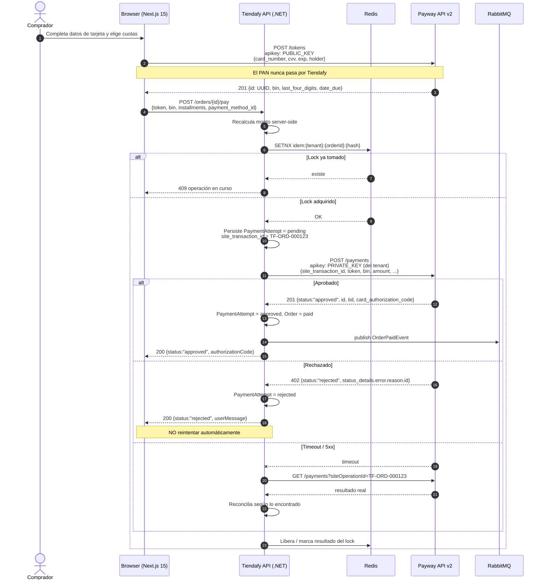
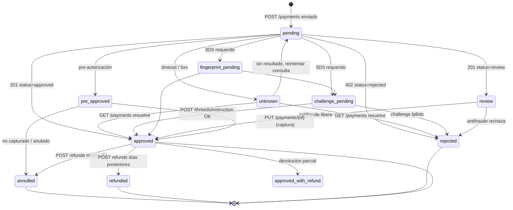

# 05 — Flujo de pago

---

## 1. Happy path — API directa con tokenización

Secuencia completa, numerada, con responsable de cada paso.

| # | Ejecuta | Acción | Qué viaja |
|---|---|---|---|
| 1 | **Browser** (Next.js) | El comprador completa el carrito y llega al checkout | — |
| 2 | **Browser → Tiendafy API** | Pide la grilla de cuotas para la tienda actual | `tenant_id`, monto del carrito |
| 3 | **Tiendafy API → Browser** | Devuelve los planes de cuotas configurados para ese tenant (**locales**, no vienen de Payway — GAP-09) | `[{ installments, coefficient, total, tea, cft }]` |
| 4 | **Browser** | El comprador tipea la tarjeta en **nuestro** formulario y elige cuotas | — |
| 5 | **Browser → Payway** | `POST /tokens` con `apikey: PUBLIC_KEY` | **PAN, CVV, vencimiento, titular, documento.** ⚠️ Va directo del browser a Payway. **No pasa por nuestro backend.** |
| 6 | **Payway → Browser** | `201` con el token | `{ id (UUID), bin, last_four_digits, date_due, ... }` |
| 7 | **Browser → Tiendafy API** | `POST /orders/{id}/pay` | `token`, `bin`, `last_four_digits`, `payment_method_id`, `installments`, `rule_id` (plan elegido). **Nunca el PAN ni el CVV.** |
| 8 | **Tiendafy backend** | Valida la orden, recalcula el monto **del lado del servidor** (nunca confiar en el total que manda el browser), genera `site_transaction_id`, adquiere lock de idempotencia en Redis | — |
| 9 | **Tiendafy backend** | Persiste un `PaymentAttempt` en estado `pending` **antes** de llamar a Payway | — |
| 10 | **Tiendafy backend → Payway** | `POST /payments` con `apikey: PRIVATE_KEY` del tenant | `site_transaction_id`, `token`, `bin`, `amount` (centavos), `currency`, `installments`, `payment_type`, `customer{}`, `establishment_name` |
| 11 | **Payway → Tiendafy backend** | `201` + `status: "approved"` (o `402` + `status: "rejected"`) | `id`, `status`, `status_details`, `tid`, `card_authorization_code`, `customer_token` |
| 12 | **Tiendafy backend** | Actualiza el `PaymentAttempt`, marca la orden como pagada, publica `OrderPaidEvent` en RabbitMQ | — |
| 13 | **RabbitMQ → consumidores** | Facturación ARCA/AFIP, descuento de stock, mail de confirmación, alta de envío en Andreani | — |
| 14 | **Tiendafy API → Browser** | Respuesta con el resultado | `{ status, orderId, authorizationCode }` |
| 15 | **Browser** | Muestra confirmación | — |

### Respuesta explícita a la pregunta clave

> **¿El número de tarjeta toca mi backend?**
> **No.** En el modelo elegido, el PAN va del browser directo a `POST /tokens` de Payway (paso 5). Nuestro backend .NET solo recibe un UUID, el BIN y los últimos 4 dígitos. Esto es lo que nos mantiene en **SAQ A-EP** en vez de SAQ D.

---

## 2. Diagrama — tokenización + pago



---

## 3. Flujo con tarjeta guardada (tokenización persistente)

Payway **no tiene un endpoint de "guardar tarjeta"**. La tarjeta se tokeniza de forma persistente **como efecto secundario del primer pago exitoso** que incluya `user_id`.

1. Primer pago: `POST /payments` con `user_id: "cust_9f2a"`. La respuesta trae un `token` persistente y un `customer_token`.
2. Pagos siguientes: `GET /usersite/cust_9f2a/cardtokens` devuelve las tarjetas guardadas (`token`, `bin`, `last_four_digits`, `expired`).
3. El comprador elige una y **solo ingresa el CVV**.
4. El browser hace `POST /tokens` con `{ token: <token persistente>, security_code: "123" }` para obtener un token de pago de un solo uso.
5. `POST /payments` normal con ese token.

Baja: `DELETE /cardtokens/{cardTokenId}`.

> **Implicancia multi-tenant:** los `user_id` viven en el espacio de nombres del `site_id`. Si cada tienda tiene su propio `site_id`, las tarjetas guardadas **no se comparten entre tiendas**, aunque sea el mismo comprador. Hay que decidir si eso es deseado (probablemente sí, por privacidad) y comunicarlo en la UI.

---

## 4. Máquina de estados de la transacción

### 4.1 Estados posibles

Fuente autoritativa: enum `Status` de https://cdn.jsdelivr.net/gh/payway-ar/sdk-java-ventaonline@V2.3.0/src/main/java/com/decidir/sdk/dto/Status.java

| Valor JSON | Interpretación para nuestra orden | Confianza |
|---|---|---|
| `approved` | **Pago aprobado.** Marcar orden como pagada, disparar fulfillment | Alta |
| `rejected` | **Rechazado.** No hay cobro. Mostrar mensaje y ofrecer otro medio | Alta |
| `review` | **En revisión por antifraude (Cybersource).** No hay cobro confirmado. **No despachar.** Requiere resolución manual o polling | Alta |
| `pre_approved` | Pre-autorizado, fondos reservados, **sin captura**. Requiere `PUT /payments/{id}` para capturar | Media — ver GAP-16 |
| `challenge pending` | 3DS: hace falta el challenge. Continuar con `POST /threeds/instruction` | Alta |
| `fingerprint pending` | 3DS: hace falta el device fingerprint. Continuar con `POST /threeds/instruction` | Alta |
| `annulled` | Anulada (reversa del mismo día, antes del cierre de lote) | Alta |
| `annulment_approved` | Anulación aprobada | Media |
| `refunded` | Devuelta (total) | Alta |
| `refund_approved` | Devolución aprobada | Media |
| `approved_with_refund` | Aprobada y con devolución **parcial** aplicada | Media |
| `accredited` | Acreditada (liquidada al comercio) | **GAP-04** |
| `reversed` | Reversada | **GAP-04** |
| `cancelled` | Cancelada | **GAP-04** |
| `adhered` | Adherida | **GAP-04** — probablemente débito automático |
| `group_rejected` | Rechazada por grupo (pago distribuido) | Media |
| `group_annulled` | Anulada por grupo (pago distribuido) | Media |
| `invoice_generated` | Cupón/factura generada (pagos offline) | Media |
| `invoice_not_generated` | No se pudo generar el cupón | Media |
| `undefined` | Estado desconocido. **Tratar como "hay que consultar"**, nunca como éxito ni fracaso | Alta |

> **GAP-04:** el significado oficial de `accredited`, `adhered`, `reversed` y `cancelled` no está documentado públicamente. Están en el enum pero sin semántica. Ver pregunta a soporte en `01-resumen-ejecutivo.md`.

### 4.2 Diagrama de estados



### 4.3 Mapeo a estados de la orden en Tiendafy

Referencia: cómo lo hace el plugin oficial de PrestaShop (https://raw.githubusercontent.com/payway-ar/plugin-prestashop/master/payway/payway.php) — crea 4 order states: `review`, `approved`, `rejected`, `annulled`.

| Estado Payway | Estado de orden Tiendafy | ¿Despacha? | ¿Factura? |
|---|---|---|---|
| `approved` | `Paid` | ✅ Sí | ✅ Sí |
| `pre_approved` | `AuthorizationHeld` | ❌ No | ❌ No |
| `review` | `PaymentUnderReview` | ❌ **No** | ❌ No |
| `challenge pending` / `fingerprint pending` | `PaymentInProgress` | ❌ No | ❌ No |
| `rejected` / `group_rejected` | `PaymentFailed` | ❌ No | ❌ No |
| `annulled` / `annulment_approved` | `Cancelled` | — | Nota de crédito |
| `refunded` / `refund_approved` | `Refunded` | — | Nota de crédito |
| `approved_with_refund` | `PartiallyRefunded` | — | Nota de crédito parcial |
| `invoice_generated` | `AwaitingOfflinePayment` | ❌ No | ❌ No |
| `undefined` / desconocido | `PaymentUnknown` | ❌ No | ❌ No, **alertar a operaciones** |

**Regla de oro:** cualquier estado no listado explícitamente cae en `PaymentUnknown` y genera una alerta. Nunca hacer `default: paid`.

---

## 5. Flujo 3D Secure

Ver `07-seguridad-3ds-pci.md` §2 para el diagrama y el detalle completo.

Resumen de la secuencia:
1. `POST /payments` con `cardholder_auth_required: true` + `auth_3ds_data{}`.
2. Respuesta con `status: "challenge pending"` (o `"fingerprint pending"`) y un `instruction_value`.
3. El browser ejecuta el challenge del emisor.
4. Backend hace `POST /threeds/instruction` con `{ id, instruction_value }`.
5. **La respuesta de ese mismo endpoint es el resultado final del pago.** No hay un segundo `POST /payments`.

---

## 6. Idempotencia

### 6.1 La API no la provee

**No existe ningún header `Idempotency-Key` ni equivalente en Payway.** Verificado por ausencia en los 5 SDKs oficiales, los 3 plugins oficiales y ActiveMerchant. Esto es una diferencia significativa contra Mercado Pago, que sí tiene `X-Idempotency-Key`.

### 6.2 Lo que sí tenemos

1. **`site_transaction_id`** — es nuestro id, viaja en el request y es **consultable** vía `GET /payments?siteOperationId={id}`. Es la pieza que hace posible la recuperación.
2. **El token de pago es de un solo uso.** Un reintento con el mismo token debería fallar del lado de Payway. Es una red de contención, no una garantía (**a validar en sandbox**).

### 6.3 Estrategia propuesta

**Tres capas, defensa en profundidad:**

**Capa 1 — Lock distribuido en Redis (previene la carrera).**
```
SET idem:{tenant_id}:{order_id}:{payload_hash} <attempt_id> NX EX 120
```
- Si el `SETNX` falla, ya hay un intento en vuelo → devolver `409` sin llamar a Payway.
- TTL de 120 s, holgadamente por encima del timeout de la llamada.

**Capa 2 — `site_transaction_id` determinístico (previene el duplicado).**
```
site_transaction_id = "TF-{tenant_short}-{order_id}-{attempt_number}"
```
- Determinístico por intento, no por request. Un mismo intento reenviado usa el **mismo** `site_transaction_id`.
- Un intento nuevo (el comprador cambió de tarjeta tras un rechazo) incrementa `attempt_number`.
- Persistir el `PaymentAttempt` **antes** de llamar a Payway. Si el proceso muere, el registro queda.

**Capa 3 — Reconciliación ante incertidumbre (repara el daño).**

Toda llamada a `POST /payments` que termine en timeout, error de red o `5xx` deja la transacción en estado `unknown`. **Nunca reintentar a ciegas.** El procedimiento es:

```
1. Esperar backoff (1s, 3s, 9s)
2. GET /payments?siteOperationId={site_transaction_id}
3. Si devuelve una transacción:
     → adoptar su status como verdad. Fin. NO reintentar.
4. Si devuelve vacío tras 3 consultas espaciadas:
     → asumir que el pago no se creó
     → habilitar un nuevo intento con attempt_number + 1 y un token nuevo
5. Si sigue ambiguo después de 5 minutos:
     → marcar la orden como PaymentUnknown
     → alertar a operaciones
     → NO despachar
```

> **Regla dura, alineada con la política oficial de Payway:** ante una transacción **denegada**, no reintentar automáticamente. Payway lo marca como mandatorio. Fuente: https://ayuda.payway.com.ar/novedades/mandatorio-no-reintentes-transacciones-denegadas-consulta-estas-instrucciones
> El reintento debe ser una acción explícita del comprador, con un token nuevo.

### 6.4 Idempotencia en devoluciones

`POST /payments/{id}/refunds` tampoco es idempotente. Un doble POST puede generar dos devoluciones. Mitigación:
1. Antes de devolver, `GET /payments/{id}/refunds` para ver el historial.
2. Lock en Redis por `payment_id`.
3. Persistir la intención de devolución antes de ejecutarla.

---

## 7. Timeouts recomendados

Los SDKs oficiales no coinciden entre sí (ver `00-cobertura-fuentes.md` §4). Valores observados: PHP 30 s, Java 79 s (¡el README dice 20!), .NET sin timeout (default 100 s), Node sin timeout, JS frontend 5 s.

La documentación del SDK PHP dice:
> *"Standard Timeout: 6 segundos; casos excepcionales con transacciones concurrentes pueden variar entre 20-30 segundos."*

**Recomendación para Tiendafy:**

| Operación | Timeout | Justificación |
|---|---|---|
| `POST /tokens` (browser) | **8 s** | No hay riesgo financiero, falla rápido y mejora la UX |
| `POST /payments` | **35 s** | Cubre el peor caso documentado (20–30 s). Un timeout corto acá **crea** el problema de duplicados |
| `POST /threeds/instruction` | 35 s | Ídem |
| `GET /payments/{id}` | 10 s | Consulta liviana |
| `POST .../refunds` | 35 s | Operación financiera |
| `GET /healthcheck` | 5 s | Probe |

**Nunca poner un timeout agresivo en `POST /payments`.** Un timeout no significa que no se cobró; significa que no sabemos. Cuanto más corto el timeout, más frecuente la ambigüedad.
