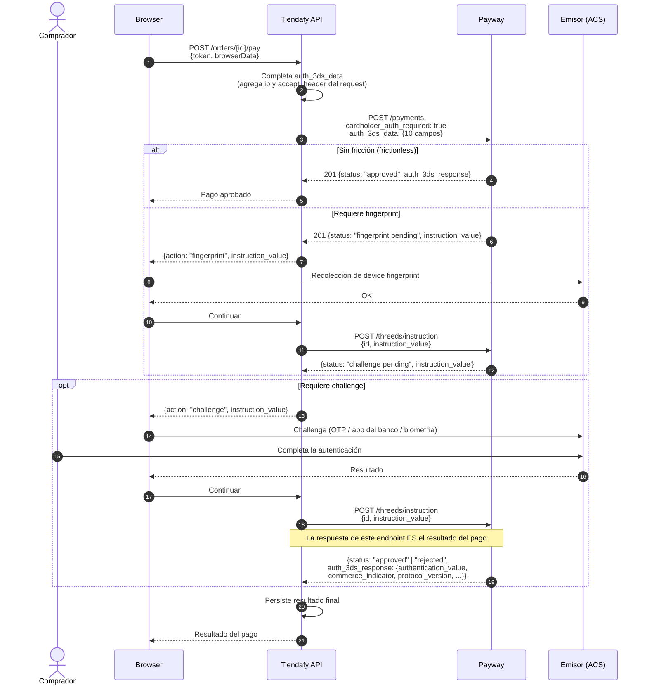

# 07 — Seguridad: 3D Secure, antifraude y PCI-DSS

---

## 1. 3D Secure

### 1.1 ¿Es obligatorio?

**No de forma automática.** 3DS se activa **explícitamente** por request, con el flag `cardholder_auth_required: true`. Si no se envía, el pago se procesa sin autenticación del tarjetahabiente.

```json
{ "cardholder_auth_required": true, "auth_3ds_data": { ... } }
```

> **Sin embargo:** la habilitación de 3DS para un comercio se configura del lado de Payway, y las marcas vienen empujando hacia autenticación obligatoria en e-commerce. **GAP:** no está documentado si Payway puede forzar 3DS a nivel de site, ni si hay reglas de negocio (monto, medio de pago, riesgo) que lo disparen del lado de ellos. **Pregunta a soporte.**

### 1.2 Versión de 3DS

Los campos de `auth_3ds_data` (`device_type`, `color_depth`, `screen_height`, `screen_width`, `time_zone_offset`, `java_enabled`, `language`, `accept_header`, `user_agent`) son exactamente los **browser data elements de EMV 3DS 2.x**. La respuesta incluye `protocol_version` y `directory_server_transaction_id`, también propios de 3DS 2.

**Conclusión:** es **EMV 3DS 2.x**. La versión exacta la devuelve `auth_3ds_response.protocol_version`. Fuente: https://raw.githubusercontent.com/payway-ar/sdk-net-ventaonline/master/Solution/Decidir/Model/Auth3dsResponse.cs

### 1.3 Campos de `auth_3ds_data`

Fuentes: https://raw.githubusercontent.com/payway-ar/sdk-php-ventaonline/master/Decidir/lib/Payment.php · https://raw.githubusercontent.com/payway-ar/sdk-net-ventaonline/master/Solution/Decidir/Model/Auth3dsData.cs

El SDK PHP recorta el objeto a **exactamente estos 10 campos**:

| Campo | Tipo | Cómo obtenerlo en el browser | Descripción |
|---|---|---|---|
| device_type | string | Constante `"BROWSER"` | Tipo de dispositivo |
| accept_header | string | Header `Accept` del request (leerlo en el backend) | Accept del browser |
| user_agent | string | `navigator.userAgent` | User-Agent |
| ip | string | IP real del cliente (`X-Forwarded-For` en el backend) | IP del comprador |
| java_enabled | bool | `navigator.javaEnabled()` | Java habilitado |
| language | string | `navigator.language` | Idioma (`"es"`, `"es-AR"`) |
| color_depth | string | `screen.colorDepth` | Profundidad de color (`"32"`) |
| screen_height | long | `screen.height` | Alto de pantalla en px |
| screen_width | long | `screen.width` | Ancho de pantalla en px |
| time_zone_offset | long | `new Date().getTimezoneOffset()` | Offset de zona horaria en minutos |

> ⚠️ **Trampa de implementación:** `accept_header` e `ip` **no se pueden obtener desde JavaScript**. El backend debe completarlos leyendo los headers del request del comprador. El resto viene del browser. Esto significa que el frontend tiene que enviar un objeto parcial y el backend completarlo — hay que diseñarlo así explícitamente.

> ⚠️ **Bug real en el SDK PHP:** en `Decidir/lib/Payment/Data.php`, la clave `time_zone_offset` está mapeada por error a `"name" => "device_type"` (copy/paste). Si alguien toma ese SDK como referencia literal, va a mandar mal el campo. **Nuestra implementación propia lo evita.**

### 1.4 Estados intermedios

Fuente: https://raw.githubusercontent.com/payway-ar/sdk-net-ventaonline/master/Solution/Decidir/Services/Service.cs

```csharp
protected const string STATUS_CHALLENGE_PENDING   = "CHALLENGE PENDING";
protected const string STATUS_FINGERPRINT_PENDING = "FINGERPRINT PENDING";
```

En el enum Java se serializan en minúsculas: `"challenge pending"` y `"fingerprint pending"` — **con espacio, no guion bajo**. Comparar de forma case-insensitive.

| Estado | Significado |
|---|---|
| `fingerprint pending` | El emisor pide recolectar el device fingerprint antes de decidir |
| `challenge pending` | El emisor pide un challenge al comprador (OTP, biometría, app del banco) |

### 1.5 Cómo se retoma el pago

**Punto clave y contraintuitivo:** el pago se retoma con `POST /threeds/instruction`, y **la respuesta de ese mismo endpoint es el resultado final del pago**. No hay un segundo `POST /payments`.

Fuente: `sendInstructionThreeDS` devuelve un `PaymentAuth3dsResponse`, que tiene la misma forma que la respuesta de `/payments`. Confirmado en Node, PHP, Java y .NET.

```
POST /api/v2/threeds/instruction
apikey: <PRIVATE_KEY>
Content-Type: application/json
X-Consumer-Username: <x_consumer_username>

{ "id": "971344", "instruction_value": "<valor devuelto por /payments>" }
```

> **GAP:** el mecanismo exacto por el cual el browser ejecuta el challenge (¿iframe? ¿redirect a una ACS URL? ¿el `instruction_value` es un JWT que se postea al ACS?) **no está documentado en ningún SDK**. Todos exponen el endpoint pero ninguno el paso del browser. Es una pregunta específica y bloqueante para soporte si se va a implementar 3DS. Ver `01-resumen-ejecutivo.md`.

### 1.6 Diagrama de secuencia 3DS



### 1.7 Respuesta 3DS

`auth_3ds_response` (https://raw.githubusercontent.com/payway-ar/sdk-net-ventaonline/master/Solution/Decidir/Model/Auth3dsResponse.cs):

| Campo | Descripción |
|---|---|
| id | Id de la autenticación |
| status | Resultado de la autenticación |
| authentication_value | **CAVV/AAV** — la prueba criptográfica de autenticación |
| commerce_indicator | **ECI** — indicador de comercio electrónico. Define quién asume el riesgo de contracargo |
| protocol_version | Versión de 3DS usada |
| directory_server_transaction_id | **DS Transaction ID** — necesario para disputas |

> **Persistir estos cuatro valores** (`authentication_value`, `commerce_indicator`, `protocol_version`, `directory_server_transaction_id`) junto con la transacción. Son la evidencia que se presenta ante un contracargo para invocar el *liability shift*. Sin ellos, el comercio se come el contracargo aunque haya hecho 3DS.

### 1.8 Recomendación para Tiendafy

**No implementar 3DS en el MVP, pero dejar el diseño preparado.**

Razones:
- El flujo del browser (paso del challenge) es un **GAP bloqueante**.
- 3DS agrega fricción y baja conversión si no está bien implementado.
- No es obligatorio hoy en la API.

Pero:
- El `IPaymentGateway` debe modelar desde el día uno un resultado `RequiresAction` con un payload opaco, para no tener que rediseñar la interfaz después. Ver `12-plan-de-implementacion.md`.
- Recolectar los datos de browser desde el MVP no cuesta casi nada y evita retrabajo.

---

## 2. Antifraude: Cybersource

### 2.1 Qué es

Payway integra **Cybersource Decision Manager** como módulo de control de fraude. Se activa con `fraud_detection.send_to_cs: true` en el request de pago.

### 2.2 Verticales

Cybersource define **seis verticales de negocio**, cada una con campos propios:

| Vertical | Uso | Campos específicos |
|---|---|---|
| **Retail** | E-commerce de productos físicos | `ship_to{}`, `items[]`, `days_to_delivery`, `dispatch_method`, `tax_voucher_required`, `customer_loyality_number`, `coupon_code` |
| Ticketing | Entradas a eventos | `days_to_event`, `delivery_type`, `items[]` |
| Digital Goods | Software, contenido digital | `delivery_type`, `items[]` |
| Services | Servicios | Referencias de pago |
| Travel | Viajes | Códigos de reserva, datos de pasajeros |
| TP Retails | — | — |

**Para Tiendafy: Retail.**

### 2.3 Campos comunes

Fuente: README del SDK .NET, sección "Integración con Cybersource"

```json
"fraud_detection": {
  "send_to_cs": true,
  "channel": "Web",
  "device_unique_id": "<device fingerprint>",
  "bill_to": {
    "city": "Buenos Aires",
    "country": "AR",
    "customer_id": "cust_9f2a",
    "email": "comprador@example.com",
    "first_name": "Juan",
    "last_name": "Pérez",
    "phone_number": "1512341234",
    "postal_code": "1427",
    "state": "C",
    "street1": "Cerrito 123",
    "street2": "Piso 4 Dto B"
  },
  "purchase_totals": { "currency": "ARS", "amount": 125045 },
  "customer_in_site": {
    "days_in_site": 243,
    "is_guest": false,
    "num_of_transactions": 3,
    "cellphone_number": "1512341234",
    "date_of_birth": "19900724",
    "street": "Cerrito 123"
  },
  "retail_transaction_data": {
    "ship_to": { "...": "misma estructura que bill_to" },
    "days_to_delivery": "5",
    "dispatch_method": "storepickup",
    "tax_voucher_required": true,
    "items": [
      { "code": "SKU-001", "description": "Notebook", "name": "Notebook",
        "sku": "SKU-001", "total_amount": 125045, "quantity": 1, "unit_price": 125045 }
    ]
  },
  "csmdds": [ { "code": 17, "description": "..." } ]
}
```

Campos marcados **MANDATORIO** en `bill_to` por el README oficial: `city`, `country` (ISO alpha-2), `customer_id` (**no puede ser un email**), `email`, `first_name`, `last_name`, `phone_number` (**sin guiones, puntos ni espacios, con código de país**), `postal_code`, `state` (código de provincia de 1 letra), `street1`. `street2` es opcional.

`channel` acepta: `"Web"`, `"Mobile"`, `"Telefonica"`.

### 2.4 Códigos de provincia (obligatorios para Cybersource)

Fuente: README del SDK .NET, "Tablas de Referencia / Provincias"

| Provincia | Código | | Provincia | Código |
|---|---|---|---|---|
| CABA | C | | Mendoza | M |
| Buenos Aires | B | | Misiones | N |
| Catamarca | K | | Neuquén | Q |
| Chaco | H | | Río Negro | R |
| Chubut | U | | Salta | A |
| Córdoba | X | | San Juan | J |
| Corrientes | W | | San Luis | D |
| Entre Ríos | R | | Santa Cruz | Z |
| Formosa | P | | Santa Fe | S |
| Jujuy | Y | | Santiago del Estero | G |
| La Pampa | L | | Tierra del Fuego | V |
| La Rioja | F | | Tucumán | T |

⚠️ **Entre Ríos y Río Negro comparten el código `R` en la tabla oficial.** Es un error de la documentación de Payway o una ambigüedad real. Consultar a soporte.

### 2.5 Device fingerprint

`fraud_detection.device_unique_id` (en el pago) y `fraud_detection.device_unique_identifier` (en la tokenización) — nótese que **los nombres difieren entre endpoints**.

> **GAP:** no está documentado **cómo se genera** el device fingerprint. Cybersource normalmente provee un script (`ThreatMetrix` / Device Fingerprint JS) que se embebe en la página y genera el id. Payway no publica ni la URL del script ni el `org_id`. **Pregunta a soporte** si se va a usar Cybersource.

### 2.6 Resultado del antifraude

La respuesta trae `fraud_detection: { status: ... }`. Las decisiones posibles, según el plugin oficial de WooCommerce:

```php
DECISION_GREEN  = 'green'
DECISION_RED    = 'red'
DECISION_YELLOW = 'yellow'
DECISION_BLUE   = 'BLUE'
DECISION_BLACK  = 'black'
CYBERSOURCE_ERROR = 'cybersource_error'
```
Fuente: https://raw.githubusercontent.com/payway-ar/plugin-woocommerce/master/wc-gateway-payway/includes/interfaces/class-wc-payway-cybersource-validator-interface.php

Interpretación **inferida** (semáforo estándar de Decision Manager) — **GAP-03**, sin confirmar:

| Decisión | Interpretación probable | Acción sugerida |
|---|---|---|
| `green` | Aprobado por antifraude | Continuar |
| `yellow` | Revisión manual | Estado `review` → no despachar |
| `red` | Rechazado por antifraude | `rejected` |
| `black` | Lista negra | `rejected`, no reintentar |
| `BLUE` | ? (nótese que es el único en mayúsculas) | Tratar como revisión |
| `cybersource_error` | Error del servicio de fraude | Decidir política: ¿aprobar o rechazar ante fallo del antifraude? |

**Recomendación:** el estado `review` de la transacción es la señal accionable. **Cualquier transacción en `review` no debe despachar mercadería.**

### 2.7 Recomendación para Tiendafy

**Fase 2, no MVP.** Cybersource agrega ~40 campos al request y tiene GAPs abiertos (device fingerprint, semántica de las decisiones). Pero:
- Diseñar el `PaymentRequest` con un campo `FraudSignals` opcional desde el día uno.
- Recolectar ya los datos de facturación y envío (los tenemos igual por la orden), para que activarlo sea llenar un mapper, no rediseñar.

---

## 3. PCI-DSS

### 3.1 Nivel derivado del modelo elegido

Con **API directa + tokenización** (Modelo A de `03-modelos-de-cobro.md`):

**SAQ A-EP** — *E-commerce merchants that outsource all payment processing to PCI DSS validated third parties, but the merchant website does not directly receive cardholder data, **but does control how consumers are redirected to the third party***.

Somos SAQ A-EP y no SAQ A porque **servimos la página que captura la tarjeta**, aunque el dato no pase por nuestros servidores. Un atacante que comprometa nuestro JS puede exfiltrar el PAN antes de que llegue a Payway (ataque tipo Magecart).

### 3.2 Obligaciones concretas de SAQ A-EP

| Obligación | Qué implica para Tiendafy |
|---|---|
| Escaneo ASV trimestral | Escaneo de vulnerabilidades externo por un Approved Scanning Vendor sobre el dominio del checkout |
| Control de cambios sobre la página de pago | Revisión y aprobación de todo cambio al checkout de Next.js |
| Integridad de scripts | **CSP estricta** en el checkout + **Subresource Integrity (SRI)** en `decidir.js`. Inventario de todos los scripts que corren en esa página |
| TLS 1.2+ | Obligatorio, sin excepciones. HSTS |
| Gestión de vulnerabilidades | Parcheo de dependencias del frontend con SLA |
| Control de acceso | MFA en todo acceso administrativo |
| Logging y monitoreo | Retención y revisión de logs |
| Política de seguridad | Documentada y revisada anualmente |

**Recomendación operativa fuerte:** minimizar la cantidad de scripts de terceros en la página del checkout. Nada de analytics de terceros, chat widgets ni tag managers en esa ruta. Es la superficie de ataque más valiosa que tenemos.

### 3.3 Qué NO persistir NUNCA

Prohibido almacenar, en base de datos, logs, caché, mensajes de RabbitMQ, trazas de APM o backups:

| Dato | Estado | Nota |
|---|---|---|
| **PAN completo** (número de tarjeta) | ❌ **Prohibido** | Ni cifrado, ni "temporalmente". No lo recibimos, no lo guardamos |
| **CVV / CVC / CVV2** | ❌ **Prohibido siempre** | PCI-DSS Req. 3.2 lo prohíbe incluso a entidades certificadas, incluso cifrado, incluso post-autorización |
| **Banda magnética / chip (track data)** | ❌ **Prohibido siempre** | No aplica en e-commerce |
| **PIN / PIN block** | ❌ **Prohibido siempre** | |
| `card_holder_birthday` | ⚠️ Evitar | Dato personal sensible sin valor para nosotros |
| `card_holder_door_number` | ⚠️ Evitar | Ídem |

### 3.4 Qué SÍ se puede persistir

| Dato | Uso | Nota |
|---|---|---|
| `bin` (6 primeros dígitos) | Obligatorio en `/payments`, y sirve para analítica | ✅ Permitido |
| `last_four_digits` | Mostrar "termina en 4905" | ✅ Permitido |
| `card_brand` | UI y reportes | ✅ |
| `expiration_month` / `expiration_year` | Mostrar vencimiento de tarjetas guardadas | ✅ |
| `card_holder_name` | ⚠️ Es dato personal, no dato de tarjeta. Guardar solo si hace falta | ⚠️ Minimizar |
| Token de pago (UUID de un solo uso) | Trazabilidad del intento | ✅ Es un token, no un PAN |
| Token persistente de tarjeta | Tarjetas guardadas | ✅ Vive en Payway, nosotros solo referenciamos |
| `customer_token` | Referencia al cliente en Payway | ✅ |
| `id` de Payway, `tid`, `card_authorization_code`, `ticket` | Conciliación y disputas | ✅ **Obligatorio guardarlos** |
| Datos 3DS (`authentication_value`, `commerce_indicator`, `directory_server_transaction_id`) | Evidencia ante contracargo | ✅ **Obligatorio guardarlos** |

> **BIN + últimos 4 juntos son aceptables** bajo PCI (no permiten reconstruir el PAN). Pero conviene no exponerlos juntos en APIs públicas.

### 3.5 Logging seguro — regla operativa

**Nunca loguear el request completo de `/tokens`.** Y como en nuestro diseño ese request ni siquiera pasa por el backend, la regla se reduce a:

```
✅ Loguear: site_transaction_id, payment_id, status, reason.id, tid,
            authorization_code, tenant_id, latencia, http_status
❌ Nunca:   token completo (loguear solo los últimos 6 caracteres),
            security_code, card_number, headers de Authorization/apikey,
            body crudo de cualquier request a Payway
```

Implementación concreta en .NET: un `DelegatingHandler` que sanitiza antes de loguear, y un redactor en Serilog para las propiedades sensibles. Ver `12-plan-de-implementacion.md`.

### 3.6 Manejo de secretos

Las API keys privadas son **por tenant** y son el activo más sensible del sistema.

- ❌ No en `appsettings.json`, ni en variables de entorno del contenedor, ni en la base sin cifrar.
- ✅ En un secret manager (Azure Key Vault / AWS Secrets Manager / HashiCorp Vault), con referencia por tenant.
- ✅ Alternativa aceptable: cifrado a nivel de columna en PostgreSQL con una DEK por tenant y una KEK en el secret manager (envelope encryption).
- ✅ Cachear en memoria con TTL corto, nunca en Redis en claro.
- ✅ Auditar todo acceso a credenciales de tenant.
