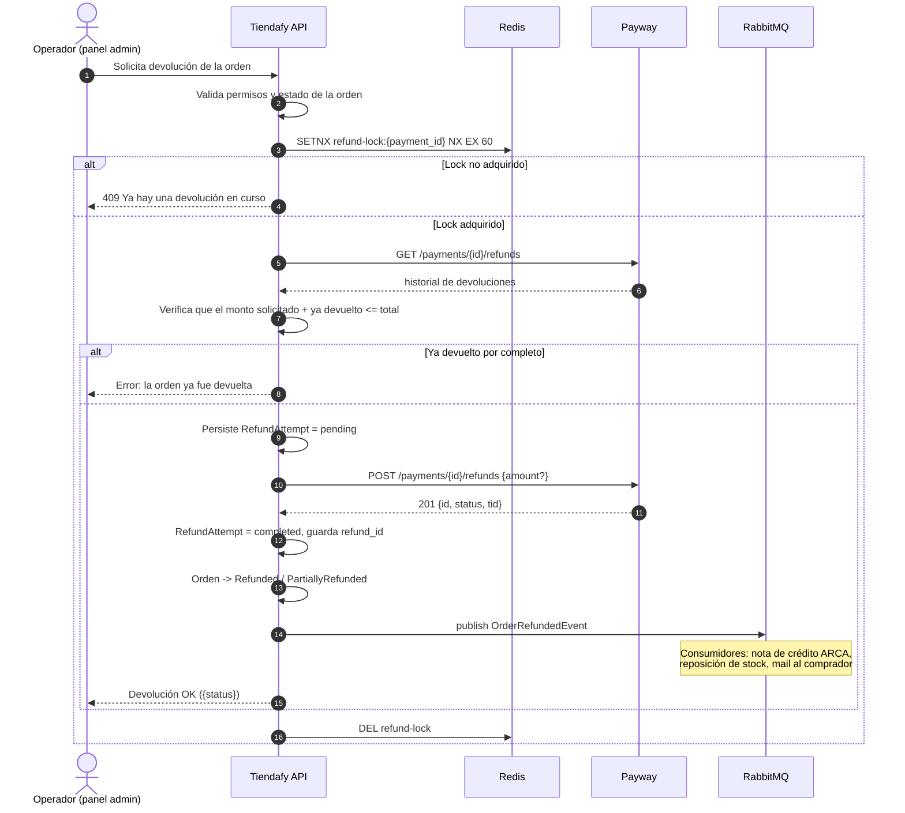

# 08 — Post-venta: anulaciones, devoluciones y consultas

---

## 1. Anulación vs. devolución — la diferencia

Payway usa **el mismo endpoint** para ambas: `POST /payments/{id}/refunds`. **La diferencia la determina el momento**, no el request.

| | **Anulación (reversa)** | **Devolución (refund)** |
|---|---|---|
| Cuándo | El **mismo día**, antes del **cierre de lote** | Después del cierre de lote |
| Qué pasa con el dinero | El cobro **nunca se presenta** al emisor | Se presenta el cobro y luego se acredita el reintegro |
| Estado resultante | `annulled` / `annulment_approved` | `refunded` / `refund_approved` |
| Impacto para el comprador | En muchos casos **ni aparece** en el resumen | Aparece el cargo y luego el crédito |
| Impacto para el comercio | Sin costo de procesamiento | Puede tener costo |
| Plazo de acreditación | Inmediato | Días a semanas, según el emisor |
| Endpoint | `POST /payments/{id}/refunds` | `POST /payments/{id}/refunds` |

**Conclusión operativa:** desde el código son la misma llamada. **El `status` de la respuesta te dice cuál ocurrió.** Nuestro dominio debe leer el status resultante y no asumir.

> **GAP:** el horario exacto del cierre de lote no está documentado. Es la variable que define la frontera anulación/devolución. **Pregunta a soporte** — es importante para poder decirle al usuario del panel admin "si cancelás antes de las X, el comprador ni lo ve".

---

## 2. Devolución total / anulación

```http
POST /api/v2/payments/{paymentId}/refunds
apikey: <PRIVATE_KEY>
Content-Type: application/json

{}
```

Body **vacío**. Fuente: `Decidir/lib/Refund/Data.php` declara `setRequiredFields(array())` — sin campos.

**Respuesta (201):**

```json
{
  "id": 164,
  "amount": 125045,
  "status": "annulled",
  "status_details": {
    "ticket": "12",
    "card_authorization_code": "203431",
    "address_validation_code": null,
    "error": null
  },
  "tid": "364656548412346",
  "sub_payments": []
}
```

| Campo | Descripción |
|---|---|
| `id` | **Id de la devolución.** Guardarlo — es lo único que permite anularla después |
| `amount` | Monto devuelto en centavos |
| `status` | `annulled` (mismo día) / `refunded` / `refund_approved` |
| `status_details.error` | `null` si salió bien. Si no, `{ type, reason: { id, description } }` |
| `tid` | Transaction ID de la marca — para conciliar contra la liquidación |

**Fuente:** https://raw.githubusercontent.com/payway-ar/sdk-php-ventaonline/master/Decidir/lib/Refund/Data.php · https://cdn.jsdelivr.net/gh/payway-ar/sdk-java-ventaonline@V2.3.0/src/main/java/com/decidir/sdk/dto/refunds/RefundPaymentResponse.java

---

## 3. Devolución parcial

**Mismo endpoint, con body.**

```http
POST /api/v2/payments/{paymentId}/refunds
apikey: <PRIVATE_KEY>

{ "amount": 50000 }
```

Para pagos distribuidos, se puede devolver por subpago:

```json
{ "sub_payments": [ { "id": 1265395, "amount": 50000 } ] }
```
donde `id` es el `subpayment_id` que devolvió el pago original.

### Restricciones conocidas

| Restricción | Detalle | Fuente |
|---|---|---|
| **Visa Débito no acepta devoluciones parciales en e-commerce** | Solo devolución total | README oficial del SDK .NET, nota al pie de la tabla de medios de pago |
| Suma acumulada | La suma de las devoluciones parciales no puede superar el monto original | Inferido |
| Cantidad máxima de devoluciones parciales | **GAP** — no documentado | |
| Plazo máximo para devolver | **GAP** — no documentado | |

**Recomendación de UI:** en el panel admin, **deshabilitar la opción de devolución parcial cuando `payment_method_id == 31` (Visa Débito)**, con un mensaje explicando por qué. Es mejor que dejar que falle contra la API.

---

## 4. Anulación de una devolución

Si se devolvió por error, se puede revertir la devolución:

```http
DELETE /api/v2/payments/{paymentId}/refunds/{refundId}
apikey: <PRIVATE_KEY>
```

- Sin body.
- Respuesta `200` o `204`. El SDK PHP convierte un `204` en `{"status":"success"}`.
- Funciona tanto para devoluciones totales como parciales — los SDKs exponen `DeleteRefund` y `DeletePartialRefund` como métodos distintos, pero **es el mismo endpoint**.

**Requiere haber guardado el `refundId`.** Si no lo guardamos, hay que recuperarlo con `GET /payments/{id}/refunds`.

**Fuente:** https://raw.githubusercontent.com/payway-ar/sdk-node-ventaonline/master/lib/services/refunds.js

---

## 5. Historial de devoluciones

```http
GET /api/v2/payments/{paymentId}/refunds
apikey: <PRIVATE_KEY>
```

Devuelve la lista de devoluciones asociadas al pago. **Es la operación que hay que llamar antes de devolver**, para no duplicar (no hay idempotencia — ver `05-flujo-de-pago.md` §6.4).

**Fuente:** https://cdn.jsdelivr.net/gh/payway-ar/sdk-java-ventaonline@V2.3.0/src/main/java/com/decidir/sdk/resources/RefundApi.java

---

## 6. Consulta de transacciones

### 6.1 Por ID de Payway

```http
GET /api/v2/payments/{paymentId}
apikey: <PRIVATE_KEY>
```

Devuelve el `PaymentResponse` completo, igual que la respuesta de `POST /payments`.

Variante con datos de tarjeta:
```http
GET /api/v2/payments/{paymentId}?expand=card_data
```
Devuelve además el PAN enmascarado y la identificación del titular. **No persistir esos datos** — ver `07-seguridad-3ds-pci.md` §3.3.

### 6.2 Por ID propio (`site_transaction_id`)

**Esta es la operación crítica de la estrategia de idempotencia.**

```http
GET /api/v2/payments?siteOperationId={site_transaction_id}
apikey: <PRIVATE_KEY>
```

| Query param | Tipo | Default | Descripción |
|---|---|---|---|
| `siteOperationId` | string | — | **Nuestro `site_transaction_id`** |
| `offset` | int | `0` | Desplazamiento |
| `pageSize` | int | `50` | Máximo de resultados |
| `merchantId` | string | — | Site del comercio. ⚠️ El SDK Java usa `siteId` para lo mismo |

**Respuesta (200):**
```json
{
  "limit": 50,
  "offset": 0,
  "results": [ { /* PaymentResponse completo */ } ],
  "has_more": false
}
```

> ⚠️ **Discrepancia entre SDKs:** el SDK Node envía `merchantId`, el SDK Java envía `siteId`. **Probar ambos en sandbox y documentar cuál funciona.**

**Paginación:** por `offset` + `pageSize`, con el flag `has_more`. Sin cursor. Para volúmenes altos, iterar hasta `has_more == false`.

> **GAP:** no hay filtros por rango de fechas ni por estado documentados. Eso limita bastante el uso del listado para conciliación masiva. **Pregunta a soporte.**

**Fuente:** https://raw.githubusercontent.com/payway-ar/sdk-node-ventaonline/master/lib/services/payments.js · README del SDK .NET

---

## 7. Flujo recomendado de devolución en Tiendafy



### Reglas de negocio a implementar

1. **Nunca devolver sin consultar el historial primero.** No hay idempotencia.
2. **Bloquear devolución parcial si `payment_method_id == 31`** (Visa Débito).
3. **Guardar el `refund_id`** de cada devolución — sin él no se puede anular.
4. **La nota de crédito de ARCA/AFIP se emite por evento**, no de forma sincrónica. Si la devolución en Payway sale bien pero la nota de crédito falla, la devolución ya ocurrió: la nota de crédito debe reintentarse desde la cola, no revertir el refund.
5. **Un `status` de devolución distinto de `annulled`/`refunded`/`refund_approved` debe alertar**, no asumirse como éxito.
6. **Persistir el `tid` de la devolución** — es lo que permite cruzarla contra la liquidación.
