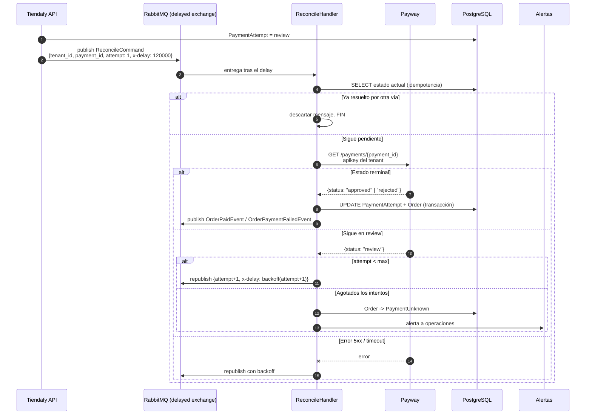

# 09 — Notificaciones y conciliación

---

## 1. Conclusión: **Payway no tiene webhooks** (con una salvedad)

Esta es la segunda conclusión de mayor impacto arquitectónico del relevamiento, después de la ausencia de API de promociones.

### 1.1 Evidencia de la ausencia

Se revisó buscando cualquier mecanismo de notificación asíncrona:

| Fuente | Resultado |
|---|---|
| README y código de `sdk-node-ventaonline` | La palabra "webhook" **no aparece** |
| README y código de `sdk-net-ventaonline` | **No aparece** |
| README y código de `sdk-php-ventaonline` | **No aparece** |
| README y código de `sdk-java-ventaonline` | **No aparece** |
| `sdk-javascript-ventaonline` | **No aparece** |
| `plugin-woocommerce` (oficial) | No implementa endpoint de callback |
| `plugin-prestashop` (oficial) | Usa el hook `paymentReturn` — **retorno sincrónico del browser**, no callback server-to-server |
| `plugin-magento-promotions` (oficial) | No aplica |
| ActiveMerchant (Shopify) | No implementa notificaciones |
| GitBook oficial histórico | Documenta *mails de confirmación* y *cierre de lote por archivo*, **no webhooks HTTP** |

**Ningún endpoint de registro/configuración de webhooks existe en la API.**

### 1.2 La salvedad: `notifications_url`

El **único** rastro de notificación asíncrona en toda la superficie de la API es un campo del **checkout hosted**:

```java
private String notifications_url;
```
Fuente: https://cdn.jsdelivr.net/gh/payway-ar/sdk-java-ventaonline@V2.3.0/src/main/java/com/decidir/sdk/dto/checkout/CheckoutRequest.java

El README del SDK Node lo describe como:
> *"URL donde se enviarán notificaciones relacionadas con la operación"*, ejemplo `"https://www.mitienda.com/notificaciones"`

**Pero:**
- Solo existe en `POST /api/v1/checkout-payment-button/link` — **no en `POST /api/v2/payments`**, que es el endpoint que vamos a usar.
- **No hay especificación del payload.**
- **No hay especificación de firma ni autenticación.**
- **No hay política de reintentos documentada.**
- **No hay rango de IPs de origen publicado.**

**GAP-06.** Es una pregunta directa y prioritaria para soporte.

### 1.3 Consecuencia arquitectónica

**Tiendafy debe diseñar para polling, no para push.** Y debe hacerlo asumiendo que eso no va a cambiar en el corto plazo.

Esto no es tan grave como suena en nuestro caso, porque:
- El flujo principal (API directa con tokenización) es **sincrónico**: `POST /payments` devuelve el resultado final en la misma respuesta. No necesitamos que nos avisen.
- El polling solo hace falta para: (a) transacciones en estado `review`, (b) transacciones en estado `unknown` tras un timeout, y (c) pagos offline con cupón.

---

## 2. Estrategia de polling

### 2.1 Cuándo hacer polling

| Caso | Frecuencia | Corte |
|---|---|---|
| **`review`** (antifraude) | 2 min, 5 min, 15 min, 30 min, 1 h, luego cada 2 h | 48 h → escalar a operaciones |
| **`unknown`** (timeout / 5xx) | 1 s, 3 s, 9 s, 30 s, 2 min, 5 min | 5 min → estado `PaymentUnknown` + alerta |
| **`challenge pending` / `fingerprint pending`** huérfano (el comprador abandonó) | 5 min, 15 min | 30 min → `PaymentAbandoned` |
| **`invoice_generated`** (pago offline) | cada 1 h | Vencimiento del cupón + 48 h |
| **`approved`, `rejected`, `refunded`, `annulled`** | ❌ **No hacer polling** | Son estados terminales |

**Nunca hacer polling de estados terminales.** Es la forma más rápida de comerse un rate limit desconocido (**GAP-07**).

### 2.2 Implementación: cola de reconciliación en RabbitMQ

Diseño propuesto, que aprovecha la infraestructura que ya tenemos:

```
Estado no terminal detectado
  → publicar mensaje en exchange `payments.reconcile`
    con header x-delay = <backoff calculado>
  → (rabbitmq_delayed_message_exchange plugin)
  → consumidor ReconcilePaymentHandler:
        GET /payments/{id}
        ├─ estado terminal → persistir, publicar evento de dominio, FIN
        └─ sigue no terminal → republicar con el siguiente backoff
                               (o escalar si se agotaron los intentos)
```

Ventajas sobre un `BackgroundService` con timer:
- El backoff es por transacción, no global.
- Sobrevive a reinicios del servicio.
- Es observable (profundidad de cola = cantidad de transacciones sin resolver).
- Escala horizontalmente sin coordinación.

### 2.3 Diagrama de recepción/reconciliación



### 2.4 Idempotencia del consumidor

Aunque hoy no haya webhooks, **el consumidor de reconciliación tiene el mismo problema de idempotencia** (RabbitMQ garantiza *at-least-once*).

Reglas:
1. **Leer el estado actual de la base antes de actuar.** Si ya está en un estado terminal, descartar el mensaje.
2. **Transiciones de estado con guardas explícitas.** `approved → rejected` no debe ser posible.
3. **UPDATE condicional** en vez de UPDATE ciego:
   ```sql
   UPDATE payment_attempts
      SET status = @newStatus, updated_at = now()
    WHERE id = @id
      AND status NOT IN ('approved','rejected','refunded','annulled');
   ```
   Si afecta 0 filas, el mensaje llegó tarde → descartar sin error.
4. **Publicar el evento de dominio dentro de la misma transacción** (patrón Outbox), para que no exista el caso "actualicé la orden pero no avisé".

### 2.5 Preparado para el día que haya webhooks

El diseño debe permitir que un webhook, si aparece, sea **una fuente más** que alimenta el mismo handler:

```
POST /webhooks/payway/{tenant_id}   →  valida firma
                                    →  persiste WebhookEvent (raw, dedupe por event_id)
                                    →  publica ReconcileCommand en la MISMA cola
```

De esa forma el webhook no ejecuta lógica de negocio: solo acelera un polling que igual iba a ocurrir. Es el diseño más robusto y el que hace que agregar webhooks después sea trivial.

---

## 3. Validación de autenticidad (para cuando exista)

Como no hay especificación (**GAP-06**), esto es el diseño defensivo a aplicar **si** Payway confirma que `notifications_url` recibe callbacks:

1. **Nunca confiar en el payload.** Tratar el webhook como una **señal**, no como un dato. Al recibirlo, hacer `GET /payments/{id}` con nuestra API key privada y usar **esa** respuesta como verdad. Esto elimina por completo el problema de la falsificación.
2. **Endpoint por tenant** (`/webhooks/payway/{tenant_id}`) con un segmento secreto de alta entropía en la URL, si Payway no ofrece firma.
3. **Allowlist de IPs** si Payway las publica.
4. **Dedupe** por `event_id` o por hash del payload, con TTL en Redis.
5. **Responder 200 rápido** y procesar asíncrono. Nunca hacer trabajo pesado en el handler HTTP.
6. **Rate limit** en el endpoint.

**El punto 1 es el más importante y hace innecesarios varios de los otros.** Un webhook que solo dispara una consulta autenticada es imposible de explotar más allá de un DoS.

---

## 4. Conciliación

### 4.1 Qué hay disponible

**GAP-15.** No se encontró documentación pública de reportes de conciliación: ni formato, ni frecuencia, ni canal de acceso.

Lo que sí sabemos:

| Elemento | Estado |
|---|---|
| `GET /payments` con paginación | ✅ Existe, pero **sin filtros por fecha ni por estado** documentados |
| `POST /api/v1/closures/batchclosure` (cierre de lote) | ✅ Existe. Contrato del request no documentado |
| Portal de comercios con reportes descargables | ⚠️ Probable, no verificado |
| API de reportes / liquidaciones | ❌ No existe evidencia |
| Archivo de conciliación (formato Prisma/Decidir) | ⚠️ El GitBook v1 menciona cierre de lote por archivo |

### 4.2 Las claves para cruzar

Independientemente del canal del reporte, estos son los campos que permiten el cruce y que **hay que persistir sí o sí**:

| Campo | Origen | Para qué sirve |
|---|---|---|
| `site_transaction_id` | Nuestro | Cruce contra nuestra orden. **Es nuestra clave primaria de negocio** |
| `id` (payment_id) | Payway | Cruce contra el reporte de Payway |
| **`tid`** | Payway (marca) | **Cruce contra la liquidación del adquirente y contra contracargos.** Solo viene en transacciones aprobadas de Visa/Master/Amex |
| `status_details.ticket` | Payway | Nro. de ticket del lote |
| `status_details.card_authorization_code` | Emisor | Código de autorización |
| `sub_payments[].tid` | Payway | En pagos distribuidos, cada subpago tiene su propio TID |
| `date` | Payway | Fecha de la operación |
| `site_id` | Payway | **Qué tienda cobró** — clave en multi-tenant |

> El README oficial del SDK .NET es explícito sobre el TID:
> *"Es un identificador único de una transacción que permite vincular una compra con una liquidación o una compra con un contracargo."*

**Guardar el TID no es opcional.** Es lo único que permite responder "¿esta liquidación corresponde a qué venta?" y "¿este contracargo es de qué orden?".

### 4.3 Proceso de conciliación propuesto

Mientras no sepamos qué reportes ofrece Payway (**GAP-15**), el proceso viable es:

```
Diario, después del cierre de lote (hora a confirmar):

1. Por cada tenant activo:
   a. Traer de nuestra base todas las transacciones del día en estado terminal
   b. GET /payments?merchantId={site_id}&pageSize=50&offset=N
      iterando hasta has_more == false
   c. Cruzar por site_transaction_id

2. Reportar tres categorías de discrepancia:
   - EN_PAYWAY_NO_EN_TIENDAFY  → cobro huérfano. CRÍTICO. Alerta inmediata.
   - EN_TIENDAFY_NO_EN_PAYWAY  → orden marcada como pagada sin respaldo. CRÍTICO.
   - MONTO_O_ESTADO_DISTINTO   → revisar caso por caso.

3. Persistir el resultado en una tabla de conciliación diaria,
   con el detalle de cada discrepancia y su resolución.
```

La primera categoría es la que más importa: **un cobro que existe en Payway pero no en Tiendafy** significa que le cobramos a alguien sin darle su pedido. Es un problema de reputación y potencialmente legal.

### 4.4 Métricas a monitorear

| Métrica | Alerta |
|---|---|
| Tasa de aprobación por tenant | Caída > 15% vs. la media móvil de 7 días |
| Transacciones en `review` sin resolver > 24 h | Cualquiera |
| Transacciones en `PaymentUnknown` | **Cualquiera → alerta inmediata** |
| Latencia p95 de `POST /payments` | > 10 s |
| Tasa de error 5xx de Payway | > 1% en 5 min |
| Profundidad de la cola de reconciliación | Creciente por más de 15 min |
| Discrepancias de conciliación diaria | > 0 |
| Distribución de `reason.id` de rechazo | Cambio abrupto en la distribución (puede indicar un problema de configuración) |
